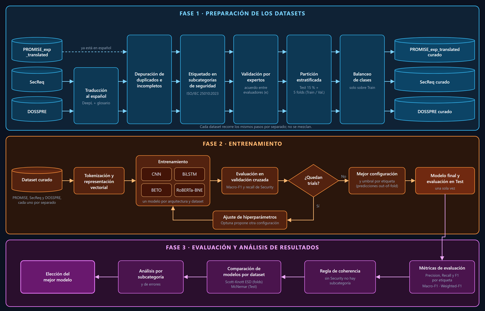

# METODOLOGÍA

La investigación seguirá un enfoque cuantitativo y experimental orientado a comparar el desempeño de BETO, RoBERTa-BNE, CNN y BiLSTM en la clasificación automática de requerimientos de seguridad en español. Cada requerimiento será clasificado de forma multietiqueta en siete salidas: su pertenencia o no a seguridad y, simultáneamente, una o más de las seis subcaracterísticas de seguridad de la ISO/IEC 25010:2023 (confidencialidad, integridad, no repudio, responsabilidad, autenticidad y resistencia), dado que un mismo requerimiento puede expresar varios atributos de calidad a la vez (ISO/IEC, 2023; Kaur & Kaur, 2023; Rejithkumar & Anish, 2025).

Se utilizarán tres datasets, PROMISE_exp_translated, SecReq y DOSSPRE, que serán preparados, entrenados y evaluados por separado, sin mezclarlos, para que el desempeño de cada arquitectura pueda analizarse en fuentes de distinto origen y tamaño (Kadebu et al., 2023; Limaylla-Lunarejo et al., 2026; Petrillo et al., 2025). El proceso se organiza en tres fases: preparación de los datasets, entrenamiento, y evaluación y análisis de resultados (Figura 4.1), siguiendo la secuencia de preparación, modelado y evaluación empleada en estudios previos de clasificación de requerimientos (Limaylla-Lunarejo et al., 2026; Wang et al., 2026).

**Figura 4.1**

*Flujo metodológico propuesto para la clasificación de requerimientos de seguridad*

*Nota.* Elaboración propia.

## 4.1. Preparación de los datasets

La primera fase transformará cada dataset de origen en un conjunto curado, listo para el entrenamiento. Para ello, los tres datasets recorrerán los mismos pasos por separado: traducción al español cuando corresponda, depuración, etiquetado en subcategorías de seguridad con validación por expertos, y partición y balanceo (Limaylla-Lunarejo et al., 2026; Kadebu et al., 2023).

### 4.1.1. Datasets de origen

La Tabla 4.1 resume los tres datasets de entrada, y las Tablas 4.2 a 4.4 describen sus esquemas originales. PROMISE_exp_translated es la versión en español de PROMISE_exp publicada por Limaylla-Lunarejo et al. (2026). Por su parte, SecReq reúne requerimientos industriales de tres especificaciones (ePurse, CPN y GPS) etiquetados como relacionados o no con seguridad (Petrillo et al., 2025; Shafikuzzaman et al., 2025). Finalmente, DOSSPRE contiene requerimientos de proyectos académicos anotados por tres expertos con una etiqueta binaria (SR/NSR) y una clase de seguridad o no seguridad (Kadebu et al., 2023).

**Tabla 4.1**

*Datasets de entrada*

| **Dataset**      | **Idioma original** | **Requerimientos**     | **De seguridad** | **Etiqueta de origen**    |
| ---------------------- | ------------------------- | ---------------------------- | ---------------------- | ------------------------------- |
| PROMISE_exp_translated | Español (traducido)      | 460                          | 79                     | Categoría RNF (SE = seguridad) |
| SecReq                 | Inglés                   | 510 (444 textos únicos)     | 177                    | sec / nonsec                    |
| DOSSPRE                | Inglés                   | 1 316 (1 283 textos únicos) | 503                    | SR / NSR y clase de seguridad   |

*Nota.* Elaboración propia a partir de Limaylla-Lunarejo et al. (2026), Petrillo et al. (2025) y Kadebu et al. (2023). Las cifras son previas a la depuración.

**Tabla 4.2**

*Esquema original de PROMISE_exp_translated*

| **Campo** | **Tipo** | **Descripción**                                                                      |
| --------------- | -------------- | ------------------------------------------------------------------------------------------- |
| *ID_NEW*      | Numérico      | Identificador del registro en el archivo balanceado de entrenamiento (solo en ese archivo). |
| *ID*          | Numérico      | Identificador del requerimiento en PROMISE_exp; vacío en los ejemplos sintéticos.         |
| *PROJECT*     | Numérico      | Proyecto de procedencia; vacío en los ejemplos sintéticos.                                |
| *REQUIREMENT* | Texto          | Requerimiento original en inglés.                                                          |
| *LABEL*       | Categórico    | Categoría original (solo en el archivo de entrenamiento).                                  |
| *PROYECTO*    | Texto          | Proyecto en la versión traducida.                                                          |
| *REQUISITO*   | Texto          | Requerimiento traducido al español.                                                        |
| *TIPO*        | Categórico    | Categoría del requerimiento: A, FT, L, LF, MN, O, PE, PO, SC, SE o US.                     |

*Nota.* De Limaylla-Lunarejo et al. (2026) y del repositorio de PROMISE_exp_translated en Zenodo.

PROMISE_exp_translated se distribuye en un archivo de entrenamiento balanceado y uno de prueba, con los campos de la Tabla 4.2. Sin embargo, el archivo de entrenamiento incluye ejemplos generados con ChatGPT, que se reconocen porque no tienen identificador ni proyecto de origen; por ello, se descartarán para trabajar solo con requerimientos reales. De las once categorías del campo *TIPO*, la categoría SE se usará como etiqueta de seguridad y el resto como ejemplos negativos. Asimismo, se conservará el texto en inglés, porque sobre él se etiquetarán las subcategorías (Limaylla-Lunarejo et al., 2026).

**Tabla 4.3**

*Esquema original de SecReq*

| **Campo**    | **Tipo** | **Descripción**                                                                |
| ------------------ | -------------- | ------------------------------------------------------------------------------------- |
| *Requerimiento*  | Texto          | Texto del requerimiento en inglés.                                                   |
| *Clasificación* | Categórico    | *sec* si el requerimiento se relaciona con seguridad; *nonsec* en caso contrario. |

*Nota.* De Petrillo et al. (2025). Cada especificación (ePurse-selective, CPN y GPS) es un archivo sin cabecera en el que ambos campos se separan con punto y coma.

En cambio, SecReq tiene la estructura más simple: tres archivos, uno por especificación, con el texto y una etiqueta binaria (Tabla 4.3). Como no incluye identificadores ni la especificación de origen, se agregará un identificador estable y la especificación a cada fila. Además, se repararán las comillas mal codificadas de los archivos originales y se descartarán dos filas de GPS, una vacía y otra con una etiqueta inválida, con lo que quedan 510 requerimientos (Petrillo et al., 2025; Shafikuzzaman et al., 2025).

**Tabla 4.4**

*Esquema original de DOSSPRE*

| **Campo** | **Tipo** | **Descripción**                                                   |
| --------------- | -------------- | ------------------------------------------------------------------------ |
| *Project ID*  | Numérico      | Proyecto académico de procedencia.                                      |
| *Class*       | Categórico    | Clase del requerimiento; su contenido depende de la versión (ver nota). |
| *Requirement* | Texto          | Texto del requerimiento en inglés.                                      |

*Nota.* De Kadebu et al. (2023). DOSSPRE se publica en tres versiones con los mismos campos y las mismas filas: 1.0 (Original), con la clase de seguridad o de no seguridad; 2.0 (Binary), con SR o NSR; y 3.0 (Multi-class), con la clase abreviada.

Por último, DOSSPRE se publica en tres versiones alineadas fila a fila, que solo difieren en el campo *Class* (Tabla 4.4). De ellas se combinarán dos: la versión 2.0 aporta la etiqueta de seguridad (SR o NSR) y la versión 1.0, la clase de seguridad que luego se convertirá a las subcaracterísticas de la ISO/IEC 25010:2023. Antes de combinarlas, se verificará que ambas versiones estén alineadas por proyecto y se limpiarán las comillas que rodean los textos (Kadebu et al., 2023; Bagies, 2024).

### 4.1.2. Traducción al español

Dado que SecReq y DOSSPRE están en inglés, se traducirán al español de España, la variante más cercana al corpus de preentrenamiento de RoBERTa-BNE (Gutiérrez-Fandiño et al., 2022). Para ello se usará DeepL con un glosario terminológico, ya que proporcionar la terminología al traductor mejora tanto la exactitud de los términos como la calidad general en la traducción inglés-español del dominio de TI (Semenov et al., 2025). Además, DeepL mantiene la comparabilidad con el antecedente, que tradujo PROMISE_exp con Google Translate y DeepL, aunque sin control terminológico (Limaylla-Lunarejo et al., 2026).

El glosario se construirá en tres pasos. En primer lugar, se extraerán del texto en inglés candidatos a término, como sintagmas nominales y siglas, con spaCy, y se ordenarán por frecuencia, especificidad y C-value (Zhang et al., 2022; Marciniak et al., 2023). A continuación, un modelo de lenguaje (Claude Sonnet 5.5) clasificará los candidatos en tres corridas independientes, y su acuerdo se validará contra la anotación humana de una muestra (Rigouts Terryn, 2026; Ahmed et al., 2025). Por último, los autores fijarán el equivalente de cada término con fuentes terminológicas abiertas, como el glosario de ciberseguridad de INCIBE, el glosario CPRE de IREB en español e IATE (INCIBE, 2024; Glinz, 2026).

Una vez traducidos, la calidad de los requerimientos se controlará con tres señales: la exactitud terminológica respecto del glosario, la estimación de calidad sin referencia de CometKiwi y la similitud semántica entre el original y la traducción (Rei et al., 2022; Semenov et al., 2025). La exactitud terminológica se medirá aparte, porque las métricas neuronales son poco sensibles a los errores de términos (Amrhein & Sennrich, 2022). Finalmente, los requerimientos marcados por alguna señal serán revisados por los autores, con umbrales calibrados sobre una muestra anotada con el protocolo de anotación de errores por tramos (Kocmi et al., 2024).

### 4.1.3. Depuración de duplicados e incompletos

Luego, se eliminarán los registros vacíos y se fusionarán los duplicados. Estos se identificarán sobre el texto original en inglés normalizado y se verificarán nuevamente sobre el texto en español, puesto que dos textos idénticos en español son la misma entrada para el modelo y, si quedaran en particiones distintas, inflarían artificialmente el desempeño (Limaylla-Lunarejo et al., 2026; Bishop et al., 2026). En el caso de los duplicados con etiquetas contradictorias en el dataset de origen, la decisión se tomará en la validación por expertos (Kadebu et al., 2023).

### 4.1.4. Etiquetado en subcategorías de seguridad y validación por expertos

La etiqueta general de seguridad se tomará de cada dataset de origen, de modo que solo los requerimientos de seguridad recibirán subcategorías (Kadebu et al., 2023; Petrillo et al., 2025). El etiquetado se realizará sobre el texto original en inglés, para que las etiquetas no dependan de la traducción, y seguirá una guía con las definiciones de la ISO/IEC 25010:2023, criterios de inclusión, reglas para los casos de frontera y ejemplos (ISO/IEC, 2023; Groen et al., 2025). En PROMISE_exp_translated y SecReq, un modelo de lenguaje propondrá una preanotación con la misma guía, acompañada de una justificación y de la opción de no decidir cuando el texto sea ambiguo; no obstante, esta preanotación no constituirá la etiqueta final (Ahmed et al., 2025; International Requirements Engineering Board, 2026).

En DOSSPRE, en cambio, la clase de seguridad asignada por los expertos de origen se convertirá a las subcaracterísticas de la ISO/IEC 25010:2023 mediante una tabla de equivalencias justificada con las definiciones de ambas fuentes (Tabla 4.5). Este procedimiento sigue la conversión documentada de Bagies (2024) y la tabla de equivalencias de Limaylla-Lunarejo et al. (2026).

**Tabla 4.5**

*Equivalencia entre las clases de seguridad de DOSSPRE y la ISO/IEC 25010:2023*

| **Clase DOSSPRE**                                 | **Subcaracterística ISO/IEC 25010:2023** |
| ------------------------------------------------------- | ----------------------------------------------- |
| Confidentiality, Authorisation                          | Confidencialidad                                |
| Integrity                                               | Integridad                                      |
| Auditing                                                | Responsabilidad                                 |
| Authentication, Identification                          | Autenticidad                                    |
| Immunity, Intrusion detection, Detection, Survivability | Resistencia                                     |
| Availability, Maintainability                           | Sin equivalente en seguridad                    |

*Nota.* Elaboración propia a partir de Kadebu et al. (2023) e ISO/IEC (2023).

Posteriormente, dos expertos en ciberseguridad validarán las etiquetas. Tras una ronda piloto para ajustar la guía, ambos anotarán de forma independiente y a ciegas una muestra estratificada de PROMISE_exp_translated y SecReq que incluya todos los casos de las subcategorías menos frecuentes, y sus diferencias se resolverán por consenso (Wellhausen et al., 2026; Rejithkumar & Anish, 2025). Sobre esa muestra, el acuerdo se medirá con una métrica adecuada para la anotación multietiqueta y con el κ de Cohen por subcategoría (Marchal et al., 2022).

A partir de ese consenso, uno de los expertos revisará el resto de los requerimientos, con la preanotación visible solo en las subcategorías en que el modelo de lenguaje haya alcanzado un acuerdo aceptable con los expertos (Ahmed et al., 2025). De forma análoga, en DOSSPRE un experto anotará a ciegas una muestra estratificada por clase, con el fin de medir el acuerdo con la tabla de equivalencias y corregir las conversiones con bajo acuerdo (Bagies, 2024).

### 4.1.5. Partición y balanceo

Con las etiquetas validadas, cada dataset se dividirá en un conjunto de prueba del 15 %, que permanecerá aislado hasta la evaluación final, y en cinco particiones de validación cruzada sobre el 85 % restante. Ambas divisiones usarán estratificación multietiqueta para conservar la proporción de cada etiqueta, y las cuatro arquitecturas usarán exactamente las mismas particiones (Limaylla-Lunarejo et al., 2026; Khan et al., 2026). Sin embargo, las subcategorías con menos de diez ejemplos positivos en un dataset se reportarán como no evaluables y no entrarán en los promedios, porque no admiten una estimación estable, aunque se conservarán en la salida del modelo (Wang et al., 2026).

Por otro lado, para compensar el desbalance, la función de pérdida podrá ponderar los ejemplos positivos de cada etiqueta con un peso calculado únicamente sobre los datos de entrenamiento de cada partición, y el uso o no de esta ponderación será un hiperparámetro más. De este modo, los conjuntos de validación y prueba conservarán solo requerimientos reales (Binkhonain & Zhao, 2023; Limaylla-Lunarejo et al., 2026; Aldhafer et al., 2026).

Como resultado de esta fase, cada dataset quedará curado con el esquema común de la Tabla 4.6, que conserva la procedencia y el texto original de cada requerimiento junto con su traducción, sus etiquetas y el origen de cada etiqueta. Esta trazabilidad permite auditar cada decisión de la preparación de los datos (Limaylla-Lunarejo et al., 2026; Rejithkumar & Anish, 2025).

**Tabla 4.6**

*Esquema de los datasets curados*

| **Campo**              | **Tipo** | **Descripción**                                                                                                                                               |
| ---------------------------- | -------------- | -------------------------------------------------------------------------------------------------------------------------------------------------------------------- |
| *ID*                       | Texto          | Identificador único del requerimiento en el dataset curado.                                                                                                         |
| *Dataset*                  | Categórico    | PROMISE_exp_translated, SecReq o DOSSPRE.                                                                                                                            |
| *Source_file*              | Texto          | Archivo o especificación de origen.                                                                                                                                 |
| *Project*                  | Texto          | Proyecto o especificación de procedencia.                                                                                                                           |
| *Source_ID*                | Texto          | Identificador del requerimiento en el dataset de origen.                                                                                                             |
| *Requirement_original*     | Texto          | Requerimiento original en inglés.                                                                                                                                   |
| *Requirement_ES*           | Texto          | Requerimiento en español utilizado para el entrenamiento.                                                                                                           |
| *Translation_source*       | Categórico    | Origen del texto en español: traducción del antecedente (PROMISE_exp_translated), DeepL con glosario, traducción alternativa o edición manual tras la revisión. |
| *Original_label*           | Texto          | Etiqueta del dataset de origen, conservada como referencia.                                                                                                          |
| *Security*                 | Binario        | 1 si el requerimiento es de seguridad.                                                                                                                               |
| *Confidentiality*          | Binario        | Subcaracterística de seguridad: confidencialidad.                                                                                                                   |
| *Integrity*                | Binario        | Subcaracterística de seguridad: integridad.                                                                                                                         |
| *Non_repudiation*          | Binario        | Subcaracterística de seguridad: no repudio.                                                                                                                         |
| *Accountability*           | Binario        | Subcaracterística de seguridad: responsabilidad.                                                                                                                    |
| *Authenticity*             | Binario        | Subcaracterística de seguridad: autenticidad.                                                                                                                       |
| *Resistance*               | Binario        | Subcaracterística de seguridad: resistencia.                                                                                                                        |
| *Subcategory_label_status* | Categórico    | Origen de las subcategorías: consenso de expertos, revisión de un experto, equivalencia de clases auditada o sin subcategorías por no ser de seguridad.           |
| *Prelabel_evidence*        | Texto          | Justificación de la preanotación o de la equivalencia de clases.                                                                                                   |

*Nota.* Elaboración propia a partir de ISO/IEC (2023) y del enfoque multietiqueta de Rejithkumar y Anish (2025).

## 4.2. Entrenamiento

Con los datasets curados, la segunda fase entrenará las cuatro arquitecturas en cada dataset por separado, de modo que se obtendrá un modelo por combinación de arquitectura y dataset y sus respectivos resultados basados en métricas para ser analizados posteriormente (Limaylla-Lunarejo et al., 2026; Wang et al., 2026).

### 4.2.1. Representación vectorial y arquitecturas

En primer lugar, el texto se convertirá en una representación numérica. Para CNN y BiLSTM, se tokenizará, se construirá un vocabulario solo con el conjunto de entrenamiento y cada token se representará con embeddings aprendidos durante el entrenamiento; para BETO y RoBERTa-BNE, en cambio, se usarán sus tokenizadores de subpalabras, con una longitud máxima de 128 tokens (Dai & He, 2025; Limaylla-Lunarejo et al., 2026).

Sobre esa representación, CNN aplicará convoluciones unidimensionales para extraer patrones locales, mientras que BiLSTM procesará la secuencia en ambas direcciones (Dai & He, 2025; Jahan Suchi et al., 2024). Por su parte, BETO y RoBERTa-BNE se ajustarán mediante fine-tuning; en RoBERTa-BNE, el dropout ajustable se aplicará solo a la capa de clasificación, porque el modelo se preentrenó sin dropout interno (Gutiérrez-Fandiño et al., 2022; Petrillo et al., 2025). En todos los casos, las arquitecturas tendrán siete salidas sigmoides independientes y se entrenarán con entropía cruzada binaria, el planteamiento habitual en la clasificación multietiqueta de requerimientos (Kaur & Kaur, 2023; Wang et al., 2026).

### 4.2.2. Ajuste de hiperparámetros y selección del modelo final

A continuación, los hiperparámetros de cada combinación de arquitectura y dataset se ajustarán con Optuna, dentro de los rangos de la Tabla 4.7 (Limaylla-Lunarejo et al., 2026; Petrillo et al., 2025). Cada configuración se entrenará y evaluará en las cinco particiones de validación cruzada, y su puntaje será el macro-F1 medio. La primera configuración evaluada será siempre la inicial, y las que muestren bajo desempeño en las primeras particiones se descartarán anticipadamente. Además, en BETO y RoBERTa-BNE el entrenamiento de cada partición se detendrá si en tres épocas no mejoran ni el macro-F1 ni la pérdida de validación (Petrillo et al., 2025; Khan et al., 2026).

**Tabla 4.7**

*Espacio de búsqueda de hiperparámetros*

| **Modelo**   | **Hiperparámetro** | **Valor inicial** | **Valores o rango** |
| ------------------ | ------------------------- | ----------------------- | ------------------------- |
| BETO y RoBERTa-BNE | Learning rate             | 2e-5                    | 1e-5 – 5e-5              |
|                    | Batch size                | 16                      | 8, 16                     |
|                    | Épocas (máximo)         | 5                       | 5, 10, 15, 20             |
|                    | Dropout de clasificación | 0,1                     | 0,1 – 0,5                |
|                    | Weight decay              | 0,01                    | 1e-8 – 0,3               |
|                    | Optimizador               | AdamW                   | AdamW, Adam               |
|                    | Warmup                    | 0                       | 0; 0,06; 0,1              |
|                    | Ponderación de positivos | No                      | Sí, No                   |
| CNN                | Dimensión del embedding  | 64                      | 64, 100, 128              |
|                    | Número de filtros        | 100                     | 100, 128                  |
|                    | Tamaño de kernel         | 3                       | 3, 4, 5                   |
|                    | Batch size                | 32                      | 16, 32                    |
|                    | Épocas                   | 50                      | 50, 60                    |
|                    | Dropout                   | 0,2                     | 0,2; 0,3; 0,4; 0,5        |
|                    | Learning rate             | 0,001                   | 0,0001 – 0,01            |
|                    | Ponderación de positivos | No                      | Sí, No                   |
| BiLSTM             | Dimensión del embedding  | 100                     | 64, 100, 128              |
|                    | Unidades                  | 64                      | 32, 64, 128               |
|                    | Capas                     | 1                       | 1, 2                      |
|                    | Batch size                | 32                      | 16, 32, 50                |
|                    | Épocas                   | 30                      | 20, 30, 50                |
|                    | Dropout                   | 0,2                     | 0,2; 0,3; 0,5             |
|                    | Learning rate             | 0,001                   | 0,0005 – 0,002           |
|                    | Ponderación de positivos | No                      | Sí, No                   |

*Nota.* Se evaluarán 30 configuraciones para CNN y BiLSTM y 12 para BETO y RoBERTa-BNE. Rangos adaptados de Limaylla-Lunarejo et al. (2026), Petrillo et al. (2025) y Jahan Suchi et al. (2024).

Concluida la búsqueda, se elegirá la configuración con mayor macro-F1 medio en validación cruzada y, ante un empate, la de mayor recall de seguridad, dada la importancia de no omitir requerimientos de seguridad (Limaylla-Lunarejo et al., 2026; Petrillo et al., 2025). Con las predicciones de validación cruzada de esa configuración se fijará un umbral de decisión por etiqueta, entre 0,40 y 0,60. Finalmente, se entrenará el modelo final con todo el 85 % de desarrollo y se evaluará una única vez en el conjunto de prueba (Wang et al., 2026; Khan et al., 2026).

## 4.3. Evaluación y análisis de resultados

La tercera fase analizará el desempeño de los modelos finales en el conjunto de prueba, primero con métricas por etiqueta y luego comparando las arquitecturas dentro de cada dataset (Limaylla-Lunarejo et al., 2026; Wang et al., 2026).

### 4.3.1. Métricas de evaluación

Para cada modelo se calcularán precision, recall y F1-score por etiqueta, junto con el macro-F1 y el weighted-F1 sobre las etiquetas evaluables, y se informará el número de ejemplos positivos de cada etiqueta junto a su F1. El macro-F1 será la métrica principal, porque asigna el mismo peso a cada etiqueta en un problema desbalanceado; además, el recall de seguridad se analizará aparte, porque mide los requerimientos de seguridad que el modelo omite (Limaylla-Lunarejo et al., 2026; Wang et al., 2026; Khan et al., 2026).

Antes de calcular estas métricas se aplicará una regla de coherencia. Como cada salida se predice de forma independiente, un modelo podría asignar una subcategoría a un requerimiento que no clasifica como de seguridad; por ello, si la predicción de seguridad es negativa, las subcategorías se anularán, y se reportará cuántas predicciones requirieron esta corrección. Este planteamiento plano con corrección posterior es una alternativa más simple a la clasificación jerárquica en dos niveles (Binkhonain & Zhao, 2023).

### 4.3.2. Comparación de modelos y elección del mejor modelo

Dentro de cada dataset, las cuatro arquitecturas se compararán con pruebas estadísticas, y no solo por la diferencia de sus promedios. Por un lado, sobre los resultados de las particiones de validación cruzada se aplicará la prueba Scott-Knott ESD, que agrupa los modelos sin diferencias significativas y considera el tamaño del efecto (Binkhonain & Alfayez, 2025). Por otro, sobre el conjunto de prueba se aplicará la prueba de McNemar a pares de modelos, como se ha hecho en la clasificación de requerimientos de seguridad sobre SecReq (Shafikuzzaman et al., 2025).

De manera complementaria, se analizará el desempeño de cada subcategoría de seguridad en relación con el número de ejemplos disponibles, y se examinarán los requerimientos mal clasificados para identificar confusiones recurrentes entre subcategorías, como las que se dan entre integridad y autenticidad o entre responsabilidad y no repudio (Petrillo et al., 2025; Wang et al., 2026).

Finalmente, en cada dataset se considerará mejor el modelo que pertenezca al grupo superior de Scott-Knott ESD y obtenga el mayor macro-F1 en prueba; si dos modelos no difieren significativamente, se preferirá el de mayor recall de seguridad. Con estos resultados se comparará, por último, el desempeño de los Transformers y de los modelos de Deep Learning entre los tres datasets (Binkhonain & Alfayez, 2025; Limaylla-Lunarejo et al., 2026).

---

## Referencias nuevas para agregar a la lista del artículo

Las demás citas ya están en la lista de referencias del borrador.

Ahmed, T., Devanbu, P., Treude, C., & Pradel, M. (2025). Can LLMs replace manual annotation of software engineering artifacts? In *2025 IEEE/ACM 22nd International Conference on Mining Software Repositories (MSR)*. IEEE. https://doi.org/10.1109/MSR66628.2025.00086

Amrhein, C., & Sennrich, R. (2022). Identifying weaknesses in machine translation metrics through minimum Bayes risk decoding: A case study for COMET. In *Proceedings of the 2nd Conference of the Asia-Pacific Chapter of the Association for Computational Linguistics and the 12th International Joint Conference on Natural Language Processing* (pp. 1125–1141). https://doi.org/10.18653/v1/2022.aacl-main.83

Bagies, T. (2024). Classifying software security requirements into confidentiality, integrity, and availability using machine learning approaches. *PeerJ Computer Science, 10*, e2554. https://doi.org/10.7717/peerj-cs.2554

Binkhonain, M., & Zhao, L. (2023). A machine learning approach for hierarchical classification of software requirements. *Machine Learning with Applications, 12*, 100457. https://doi.org/10.1016/j.mlwa.2023.100457

Glinz, M. (2026). *Glosario de terminología de ingeniería de requisitos – español* (v2.2.1). IREB e.V. https://hub.ireb.org/media/pages/resources/cpre-glossary/b9cf057b7a-1787039949/ireb_cpre_glossary_es_2.2.1.pdf

Groen, E. C., Dalpiaz, F., van Vliet, M., Winter, B., Doerr, J., & Brinkkemper, S. (2025). Classification of quality characteristics in online user feedback using linguistic analysis, crowdsourcing and LLMs. *Journal of Systems and Software, 230*, 112533. https://doi.org/10.1016/j.jss.2025.112533

Gutiérrez-Fandiño, A., Armengol-Estapé, J., Pàmies, M., Llop-Palao, J., Silveira-Ocampo, J., Carrino, C. P., Armentano-Oller, C., Rodriguez-Penagos, C., Gonzalez-Agirre, A., & Villegas, M. (2022). MarIA: Spanish language models. *Procesamiento del Lenguaje Natural, 68*, 39–60. https://doi.org/10.26342/2022-68-3 [Verificar la lista de autores y las páginas en la revista]

INCIBE. (2024). *Glosario de términos de ciberseguridad*. Instituto Nacional de Ciberseguridad.

International Requirements Engineering Board. (2026). *Prompt Guide: Tag Requirements*. En *AI4RE Prompt Guide*. IREB e.V. Recuperado el 18 de octubre de 2026 de https://ireb.atlassian.net/wiki/spaces/airebpromptguide/pages/2430369836/Prompt+Guide+Tag+Requirements

Kocmi, T., Zouhar, V., Avramidis, E., Grundkiewicz, R., Karpinska, M., Popović, M., Sachan, M., & Shmatova, M. (2024). Error span annotation: A balanced approach for human evaluation of machine translation. In *Proceedings of the Ninth Conference on Machine Translation* (pp. 1440–1453). https://doi.org/10.18653/v1/2024.wmt-1.131

Marchal, M., Scholman, M., Yung, F., & Demberg, V. (2022). Establishing annotation quality in multi-label annotations. In *Proceedings of the 29th International Conference on Computational Linguistics* (pp. 3659–3668). https://aclanthology.org/2022.coling-1.322/

Marciniak, M., Rychlik, P., & Mykowiecka, A. (2023). TermoUD – a language-independent terminology extraction tool. In *Proceedings of the 17th Conference of the European Chapter of the Association for Computational Linguistics: System Demonstrations* (pp. 178–186). https://doi.org/10.18653/v1/2023.eacl-demo.21

Rei, R., Treviso, M., Guerreiro, N. M., Zerva, C., Farinha, A. C., Maroti, C., de Souza, J. G. C., Glushkova, T., Alves, D., Coheur, L., Lavie, A., & Martins, A. F. T. (2022). CometKiwi: IST-Unbabel 2022 submission for the quality estimation shared task. In *Proceedings of the Seventh Conference on Machine Translation* (pp. 634–645). https://doi.org/10.18653/v1/2022.wmt-1.60

Rigouts Terryn, A. (2026). Large language models are good term extractors: A systematic evaluation. In *Proceedings of LREC 2026* (pp. 7631–7643). https://aclanthology.org/2026.lrec-1.605/

Semenov, K., Huang, X., Zouhar, V., Berger, N., Zhu, D., Oncevay, A., & Chen, P. (2025). Findings of the WMT25 terminology translation task: Terminology is useful especially for good MTs. In *Proceedings of the Tenth Conference on Machine Translation* (pp. 554–576). https://doi.org/10.18653/v1/2025.wmt-1.30

Wellhausen, C., Reinhardt, L., & Schneider, K. (2026). User reviews as a source for usability requirements: A precursor study on using large language models. In *REFSQ 2026 Workshops*. CEUR-WS. [Completar volumen]

Zhang, J., Chen, S., Hua, J., Niu, N., & Liu, C. (2022). Automatic terminology extraction and ranking for feature modeling. In *2022 IEEE 30th International Requirements Engineering Conference (RE)* (pp. 51–63). IEEE. https://doi.org/10.1109/RE54965.2022.00012
