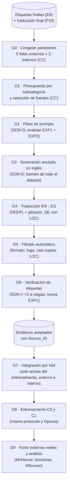

# Plan de aumento de datos con LLM para las subcategorías de seguridad

Versión 1 · 25-10-2026. Se ejecuta **después** de
[`PLAN_ETIQUETADO_SUBCATEGORIAS.md`](PLAN_ETIQUETADO_SUBCATEGORIAS.md) (E8) y de
[`PLAN_TRADUCCION_GLOSARIO.md`](PLAN_TRADUCCION_GLOSARIO.md) (P10): solo se aumenta sobre
etiquetas y traducciones finales.

> **A quién va dirigido.** A los autores de la tesis, para ejecutar el plan, y a un LLM que
> redactará la metodología. Para el LLM redactor:
>
> - Cita **solo** las fuentes de la sección "Referencias" (2022 en adelante, revisadas por pares).
> - Lo marcado **[Decisión propia]** no tiene respaldo bibliográfico: preséntalo como decisión de
>   diseño de los autores, con su razón. Lo marcado **[NV]** no se pudo verificar: no lo afirmes.
> - **El aumento es un factor experimental, no una mejora garantizada.** La evidencia es mixta
>   (sección 1.2): redáctalo como una pregunta de investigación con su hipótesis nula.
> - **No citar** Synthline (El-Hajjami y Salinesi, 2025): es un preprint de arXiv sin versión
>   revisada por pares encontrada.
> - Validación y prueba contienen **solo requisitos reales**. Ningún sintético se evalúa.

---

## 0. Decisiones previas que este plan asume

| Fecha | Decisión |
|---|---|
| 25-10-2026 | **Non_repudiation y Accountability se descartan en los tres datasets** por falta de datos (0/2/0 y 4/4/38 positivos). Quedan cinco salidas: Security, Confidentiality, Integrity, Authenticity y Resistance. Precedente: Bishop et al. (2026) excluyeron las categorías Volere sin semillas suficientes (Cultural, Political y Legal). |
| 25-10-2026 | **Availability y Maintainability de DOSSPRE pasan a `Security=0`** (95 requisitos; Security baja de 501 a 406). En ISO/IEC 25010 pertenecen a Fiabilidad y Mantenibilidad, y así quedan alineadas con las clases A y MN de PROMISE, que ya eran `Security=0`. Kadebu et al. (2023) y Hassan et al. (2025) las tratan como seguridad; se citan como alcance alternativo que la tesis no adopta. Implementado en `scripts/prepare_datasets.py` (`DOSSPRE_OUT_OF_SECURITY`). |
| 25-10-2026 | La taxonomía es ISO/IEC 25010:2023. No se adoptan las 10 clases de Kadebu et al. (2023) ni de Hassan et al. (2025): solo DOSSPRE las trae etiquetadas y repartirían aún menos positivos por clase. |

| 25-10-2026 | **CV anidada** en lugar del test fijo del 15 %: 5 folds externos para evaluar (cada requisito se evalúa una vez) y 3 folds internos para Optuna dentro de cada externo. |
| 26-10-2026 | **Trials por fold externo: 25 (CNN, BiLSTM) y 12 (BETO, RoBERTa-BNE)**, iguales en C0 y C1, alcanzados **en dos etapas** para todos los modelos: primero 15/15/6/6 y luego se extiende el mismo estudio (`scripts/extend_trials.py`), porque la semilla de TPE y sus trials aleatorios iniciales dependen de cuántos trials ya existen. Los 12 de los transformers son los de los notebooks originales; los 25 de CNN y BiLSTM (30 en los notebooks) son **[Decisión propia]** por tiempo de cómputo. Cada etapa queda archivada en `stage_<n>trials/`. |

Implementado el 25-10-2026: cinco salidas en `src/config.py` y `scripts/prepare_datasets.py`
(Auditing de DOSSPRE queda con `Security=1` y sin subcategoría), CV anidada en `src/data.py` y
`src/pipeline.py`, y particiones nuevas en `artifacts/splits/` (los manifiestos guardan las
etiquetas, así que un cambio de etiquetas obliga a regenerarlos).

---

## 1. Qué se aumenta y por qué

### 1.1 Pregunta e hipótesis

- **Pregunta:** ¿agregar al entrenamiento requisitos generados por un LLM mejora el F1 de las
  subcategorías de seguridad, evaluado sobre requisitos reales?
- **H0:** no hay diferencia significativa de F1 entre entrenar solo con datos reales (C0) y con
  reales más sintéticos (C1). **H1:** sí la hay.
- **Alcance:** solo las subcategorías **evaluables** de cada dataset (al menos 10 positivos,
  `MIN_POSITIVES_PER_LABEL`). El aumento **no vuelve evaluable** una etiqueta, porque la prueba
  sigue siendo real.

### 1.2 Qué dice la evidencia (resumen para la discusión)

| Estudio | Diseño | Resultado en F1 |
|---|---|---|
| Limaylla-Lunarejo et al. (2026), español, ChatGPT, BETO | Original frente a balanceado (ChatGPT en clases raras + submuestreo); prueba real | El mejor modelo global empeora (0,82 → 0,76 ponderado); BETO mejora (macro 0,68 → 0,75; Security 0,81 → 0,84); en otro dataset real (ReSpaN) el balanceado es peor (BETO macro 0,40 → 0,34) |
| Pham et al. (2025), GPT-4o | Real, sintético y combinado; prueba en PROMISE y en PURE | En PROMISE, real 0,80 > combinado 0,77 > sintético 0,51; en PURE, sintético y combinado 0,74 > real 0,68. **Security en PURE: 0,80 / 0,80 / 0,81, sin ganancia** |
| Oghabi y Kahani (2025), multietiqueta | Retrotraducción solo en entrenamiento; prueba de 255 requisitos anotados por humanos | RoBERTa macro-F1 75,61 → 78,84 |
| Møller et al. (2024) | 10 tareas, GPT-4 y Llama-2 | Los datos humanos igualan o superan a los sintéticos; el aumento ayuda en clases raras |
| Li et al. (2023) | Varias tareas | Cuanto más subjetiva la tarea, peor rinde el sintético |
| Kaur y Roy (2026) | Aumentan **antes** de dividir | +0,2 a 3,76 % de accuracy, con posible fuga: **contraejemplo de diseño**, no evidencia |
| Bishop et al. (2026) | Prueba sintética | F1 0,88 que no mide la transferencia a datos reales: **contraejemplo de diseño** |

**Lectura:** con prueba real, las ganancias son pequeñas y concentradas en clases raras, y a veces
se pierde rendimiento global o generalización. Por eso C1 se compara con C0 bajo el mismo protocolo.

---

## 2. Actores

| Código | Quién | Qué hace en este plan |
|---|---|---|
| **A1** | Autor 1 (Franco) | Ejecuta los scripts, prepara las planillas, modera el piloto, calcula los resultados. **No decide etiquetas.** |
| **A2** | Autora 2 (coautora) | Verifica las planillas y el registro de corridas. **No decide etiquetas.** |
| **EXP1** | Experto principal del plan de etiquetado | Evalúa el piloto de prompts (G2) y revisa las etiquetas de los sintéticos (G6). |
| **EXP2** | Segundo experto del plan de etiquetado | Evalúa el piloto de prompts (G2). |
| **SON-G** | `claude-sonnet-5-5`, por la suscripción de Claude, como subagentes de Claude Code (sin API) | **Genera** los requisitos sintéticos (G3). |
| **SON-V** | El mismo modelo, en subagentes **distintos** de los de SON-G | **Verifica a ciegas** la etiqueta de cada sintético (G6). No ve la etiqueta pretendida. |
| **DEEPL** | DeepL API Free con el glosario del plan de traducción | Traduce los sintéticos (G4). |
| **LOC** | LaBSE y CometKiwi (los mismos del plan de traducción) | Similitud y control de calidad (G4, G5). |
| **CC** | Claude Code | Scripts de presupuesto, generación, filtrado, integración y análisis, bajo la supervisión de A1. |

- Si solo se consigue un experto, EXP1 hace también el piloto; se declara como limitación, igual
  que en el plan de etiquetado.
- **No se usa ningún LLM local** (GPU de 4 GB).

---

## 3. Flujo



---

## 4. Pasos

### G0 · Congelar las particiones antes de generar

- **Quién:** CC.
- **Paso a paso:**
  1. Con las etiquetas finales y las cinco salidas, se generan los 5 folds externos y, dentro del
     entrenamiento de cada externo, 3 folds internos (estratificación multietiqueta iterativa,
     semilla 42). Archivos: `artifacts/splits/<dataset>_outer_folds_seed42.csv` y
     `<dataset>_outer<k>_inner_folds_seed42.csv`.
  2. Los manifiestos guardan el hash del texto y las etiquetas, y se congelan **antes** de generar.
     El aumento no puede cambiarlos.
  3. **Con CV anidada todo requisito real puede ser fuente**, porque cada uno es de prueba en un
     solo fold externo; G7 excluye sus variantes de ese fold. Ningún sintético se evalúa.
- **Respaldo:** Limaylla-Lunarejo et al. (2026) y Oghabi y Kahani (2025): el aumento se aplica solo
  al entrenamiento y la prueba queda intacta. Kaur y Roy (2026) aumentan antes de dividir: es la
  fuga que este paso evita. La CV anidada es **[Decisión propia]**: con un test fijo del 15 %, las
  etiquetas raras quedaban con 1 a 3 positivos de prueba.

### G1 · Presupuesto por subcategoría y selección de fuentes

- **Quién:** CC; A1 revisa la tabla resultante.
- **Paso a paso:**
  1. Para cada dataset y cada subcategoría evaluable `c`, con `n_c` positivos reales en el
     dataset y `n_max` el de la subcategoría más frecuente de ese dataset:

     `n_aug_c = min(2 · n_c, n_max − n_c)`

     El objetivo `n_max` sigue a Aldhafer et al. (2026); el tope `2 · n_c` (como máximo unas dos
     variantes por requisito real) es **[Decisión propia]**: el experimento 2 previo mostró que
     muchas variantes de pocas semillas no aportan diversidad (`old/AJUSTE_HIPERPARAMETROS_SEGURIDAD.md`).
  2. **Selección voraz de fuentes con co-ocurrencia:** cada variante hereda el vector completo de
     subcategorías de su fuente, así que una fuente con {Confidentiality, Integrity} suma a las
     dos. Se ordenan las fuentes por el peso de clase de Aldhafer et al. (2026, ec. 6), que
     favorece a las que tienen etiquetas raras. Se asigna una variante a la vez y se recalculan los
     faltantes. Máximo 2 variantes por fuente.
  3. Solo son fuentes los requisitos con `Security=1` y al menos una subcategoría evaluable. No se
     generan negativos. **[Decisión propia]**
  4. Se generan unas **1,5 veces** las variantes asignadas (2 o 3 por fuente), para cubrir lo que
     eliminen G5 y G6. **Desde la versión 2 del filtro se aceptan todas las que pasen**, sin
     recortar a las asignadas: el total puede superar `n_aug_c` hasta en 1,5 veces.
     **[Decisión propia]**
- **Presupuesto con las etiquetas provisionales del 25-10-2026** (`scripts/augmentation/g1_budget.py`;
  cambiará con el etiquetado final):

  | Dataset | Positivos reales (C / I / A / R) | `n_max` | `n_aug` objetivo (C / I / A / R) | Fuentes | Variantes a aceptar | Pedidas |
  |---|---|---:|---|---:|---:|---:|
  | PROMISE | 37 / 14 / 18 / 10 | 37 | 0 / 23 / 19 / 20 | 34 | 62 | 100 |
  | SecReq | 31 / 60 / 70 / 12 | 70 | 39 / 10 / 0 / 24 | 47 | 73 | 115 |
  | DOSSPRE | 123 / 33 / 92 / 120 | 123 | 0 / 66 / 31 / 3 | 66 | 100 | 167 |

  Resistance de PROMISE tiene 10 positivos en total y queda en el límite de evaluable: si el
  etiquetado final la deja por debajo de 10, sale del aumento y de los promedios.
- **Salida:** `datasets/interim/augmentation/budget.csv`, `sources.csv` (fuente, subcategorías,
  variantes a aceptar y a pedir, dominios sorteados) y `gen_batches/`.

### G2 · Diseño del prompt y piloto

- **Quién:** CC redacta las variantes; SON-G genera; EXP1 y EXP2 evalúan; A1 modera.
- **Prompt base (variante V1)**, en inglés. Combina el rol y la definición contextualizada a un
  tipo de software de Pham et al. (2025) con el requisito real como ancla y las cualidades de
  ISO/IEC/IEEE 29148 de Limaylla-Lunarejo et al. (2026):

  ```text
  You are a requirements engineer specialised in information security.

  ISO/IEC 25010:2023 security sub-characteristics (definitions from the annotation guide):
  {DEFINITIONS of Confidentiality, Integrity, Authenticity, Resistance + boundary rules}

  A good requirement is necessary, implementation-free, unambiguous, consistent, complete,
  singular, feasible, traceable and verifiable.

  Source requirement (real, for reference only): "{SOURCE_REQUIREMENT_EN}"
  It expresses exactly these sub-characteristics: {LABELS}

  Write {K} new software requirements, one per target system type: {DOMAINS}.
  Each requirement must:
  - express exactly the same sub-characteristics ({LABELS}) and no other security
    sub-characteristic;
  - be a single, complete sentence in English using a modal verb (shall/must);
  - describe a situation of the target system, not paraphrase the source; do not reuse any phrase
    of four or more words from the source;
  - not rely on trigger words alone ("secure", "protected", "password") to convey the label.
  Answer only with JSON: [{"domain": ..., "requirement": ...}, ...]
  ```

- **Variantes del piloto:**
  - **V1:** el prompt base.
  - **V2:** V1 sin el requisito fuente: solo definiciones y tipo de software, como Pham et al.
    (2025).
  - **V3 descartada:** con 5 requisitos reales como ejemplos (Limaylla-Lunarejo et al., 2026), un
    sintético solo podría usarse en los folds donde sus 5 fuentes estén en entrenamiento, algo que
    con folds externos e internos casi no ocurre.
- **Tipos de software** (`{DOMAINS}`), los 10 de Pham et al. (2025): navegador web, servidor de
  base de datos, control de tráfico aéreo, simulación, nómina y recursos humanos, compilador,
  almacén de datos, reservas en línea, previsión de ventas y captura de pantalla. Se sortea uno
  distinto por variante. Se podrán añadir tipos de los dominios de los datasets (banca, salud,
  transporte). **[Decisión propia]**
- **Paso a paso:**
  1. Cada variante genera 20 ítems sobre las mismas fuentes.
  2. EXP1 y EXP2 los califican por separado con una rúbrica: (a) la etiqueta pretendida es
     correcta; (b) es un requisito plausible y bien formado; (c) no es una paráfrasis de la fuente;
     (d) no introduce otra subcategoría.
  3. Se elige la variante con menos ítems descartados por consenso. Los 60 ítems del piloto **no
     entran** al entrenamiento.
- **Respaldo:** Bishop et al. (2026): piloto de 11 estrategias de prompt, 20 ítems cada una,
  evaluadas con rúbrica por expertos en un Delphi modificado; la estrategia combinada fue la mejor.
  Pham et al. (2025): rol, definición contextualizada y generación por clase.
  Limaylla-Lunarejo et al. (2026): system prompt con definiciones y las 9 cualidades de un buen
  requisito, y ejemplos reales del entrenamiento.
- **Salida:** `datasets/interim/augmentation/prompt_gen_v<n>.md` (con hash) y
  `pilot_ratings.csv`. La versión 1 (`prompt_gen_v1.md`, hash `1e13988b0b26`) es V1 con los
  10 tipos de software de Pham et al. (2025) más 4 dominios de los datasets.

### G3 · Generación anclada en inglés

- **Quién:** SON-G, orquestado por CC.
- **Paso a paso:**
  1. Un subagente nuevo (contexto limpio) por lote de 12 fuentes; para cada fuente pide sus `K`
     variantes asignadas en G1 (con el factor de 1,5), cada una en un tipo de software distinto.
  2. Cada sintético guarda `Anchor_ID` (el `ID` del requisito real), `Prompt_version`, `Domain` y
     el vector de subcategorías **pretendido** (el de su fuente).
  3. Se registra igual que en P3 del plan de traducción: modelo, versión de Claude Code, fecha UTC,
     hash del prompt y archivos. Las salidas se congelan.
- **Por qué en inglés:** el corpus real de entrenamiento es traducción automática (DeepL en SecReq
  y DOSSPRE; Google Translate y DeepL en PROMISE, según Limaylla-Lunarejo et al., 2026). Si el
  sintético pasa por la misma traducción, tiene el mismo estilo que los datos reales, y la
  verificación de etiquetas se hace en inglés, como en el plan de etiquetado. Generar
  directamente en español, como Limaylla-Lunarejo et al. (2026), daría otro estilo.
  **[Decisión propia]**
- **Por qué anclada a una fuente:** permite generar **una sola vez** sobre el 85 % y luego filtrar
  por fold (G7), sin regenerar para cada fold y sin fuga. **[Decisión propia]**
- **Respaldo:** Pham et al. (2025): generación por clase con contexto de tipo de software para
  diversificar. Bishop et al. (2026): cada llamada en una conversación nueva. Sallou et al. (2024)
  y Ouyang et al. (2024): registrar y congelar salidas de LLM no deterministas.
- **Salida:** `gen_runs/batch_XX.jsonl` (salidas congeladas), `generated_raw.csv` y
  `generated_meta.json` (`scripts/augmentation/g3_collect.py`, que valida conteo, orden, anclas y
  dominios, y marca los que no tienen verbo modal o reutilizan 4 palabras seguidas de la fuente).

### G4 · Traducción al español

- **Quién:** DEEPL, con el script de P6; LOC para el control de calidad.
- **Paso a paso:**
  1. Se traduce con el mismo glosario, los mismos parámetros y el mismo `context` que P6.
  2. Se aplican las señales automáticas de P8 (exactitud terminológica, CometKiwi, LaBSE).
  3. **Un sintético marcado por P8 se descarta, no se revisa.** Es más barato generar otro que
     corregirlo. Mientras P9 no calibre umbrales, se marca si CometKiwi o LaBSE quedan por debajo
     del percentil 5 del corpus real traducido (0,7962 y 0,8035) o si la exactitud terminológica
     es menor que 0,5. **[Decisión propia]**
- **Respaldo:** las mismas fuentes que P6 y P8 del plan de traducción (Semenov et al., 2025; Rei et
  al., 2022; Feng et al., 2022).

### G5 · Filtrado automático

- **Quién:** CC con LOC.
- **Paso a paso:**
  1. **Formato:** una oración, en el idioma esperado, sin texto fuera del requisito. Se eliminan
     los duplicados exactos.
  2. **Fuga contra todos los reales, incluida la prueba:** se descarta todo sintético con similitud
     coseno de LaBSE ≥ 0,90 con **cualquier** requisito real del dataset, en inglés o en español.
     El LLM puede haber memorizado PROMISE o SecReq y reproducir un requisito de prueba.
     **[Decisión propia]** el umbral; se reporta cuántos caen.
  3. **Casi copias de la fuente:** se descartan los sintéticos con similitud coseno LaBSE ≥ 0,85
     con su fuente. **[Decisión propia]** el umbral. La versión 1 usaba el tercer cuartil de la
     distribución del dataset, como Limaylla-Lunarejo et al. (2026), pero con LaBSE ese cuartil cae
     en 0,60-0,64, donde los requisitos ya no son copias sino escenarios distintos del mismo tema
     (ellos obtienen 0,95 con word2vec). Solo 5 de 382 superaban 0,75. Se corrigió el 26-10-2026.
  4. **No se hace la poda entre clases** de Bishop et al. (2026): en multietiqueta la superposición
     entre subcategorías es legítima y eliminarla volvería el conjunto más fácil que el real.
- **Respaldo:** Limaylla-Lunarejo et al. (2026): eliminan los generados con similitud mayor al
  tercer cuartil (0,95 en su caso, con word2vec SBWCE). Feng et al. (2022): LaBSE.

### G6 · Verificación de etiquetas

- **Quién:** SON-V a ciegas; EXP1 revisa.
- **Paso a paso:**
  1. SON-V clasifica cada sintético en inglés con el **prompt de preanotación del plan de
     etiquetado** (E2, versión 2), sin ver la etiqueta pretendida. Tres corridas independientes y
     voto mayoritario por etiqueta.
  2. Se conserva el sintético solo si el voto coincide **exactamente** con el vector pretendido en
     las subcategorías evaluables y no tiene ninguna etiqueta en `unclear`.
  3. **Revisión humana:**
     - Si quedan 300 sintéticos o menos en un dataset (es lo esperado según G1), EXP1 revisa
       **todos**, como Limaylla-Lunarejo et al. (2026).
     - Si quedan más, EXP1 revisa una muestra por subcategoría con el tamaño de Cochran (95 %,
       ±5 %) y se estima la proporción de ítems de baja calidad con el intervalo de Wilson. Se
       acepta la subcategoría si el límite superior queda por debajo del 10 %; si no, se corrige el
       prompt y se regenera esa subcategoría (Bishop et al., 2026).
  4. EXP1 marca cada ítem como aceptado, rechazado por etiqueta o rechazado por calidad. Se reporta
     el acuerdo entre SON-V y EXP1.
- **Respaldo:** Bishop et al. (2026): validación por expertos con muestra de Cochran e intervalo de
  Wilson, y criterio de aceptación del 10 %. Limaylla-Lunarejo et al. (2026): revisión individual
  de la etiqueta de todos los generados (de 312 quedaron 245). Ahmed et al. (2025): el acuerdo
  LLM–humano se interpreta frente al acuerdo entre humanos.
- **Salida:** `datasets/interim/augmentation/synthetic_<dataset>.csv`.

### G7 · Integración por fold

- **Quién:** CC, bajo la supervisión de A1.
- **Esquema** de `synthetic_<dataset>.csv`: el de la Tabla 4.6 de la metodología, más:

  | Campo | Descripción |
  |---|---|
  | `Is_synthetic` | 1 en todos los sintéticos |
  | `Anchor_ID` | `ID` del requisito real del que se generó |
  | `Prompt_version`, `Domain` | Variante del prompt (G2) y tipo de software sorteado |
  | `Filter_status` | `accepted`; los rechazados se guardan aparte con su motivo (G4, G5 o G6) |
  | `Label_verified_by` | `SON-V+EXP1` o `SON-V+EXP1_sample` |

- **Paso a paso:**
  1. En cada fold **interno**, el entrenamiento recibe solo los sintéticos cuyo `Anchor_ID` está
     en el entrenamiento de ese fold interno. La validación queda solo con reales.
  2. En cada fold **externo**, el modelo que predice la prueba se entrena con los reales del
     entrenamiento externo más los sintéticos cuyo `Anchor_ID` está ahí. Los sintéticos de las
     fuentes que caen en la prueba de ese externo quedan fuera (cerca del 80 % de los sintéticos
     entra en cada externo).
  3. CNN y BiLSTM construyen su vocabulario con el entrenamiento del fold, sintéticos incluidos.
     `pos_weight` se calcula con ese mismo entrenamiento. **[Decisión propia]**
  4. **Prueba unitaria** (`tests/test_protocol.py`, `test_synthetic_rows_never_leak_into_evaluation`):
     en los dos niveles, ningún sintético tiene su ancla en la parte evaluada, ninguna parte
     evaluada contiene filas sintéticas y ningún texto sintético coincide con uno evaluado.
- **Respaldo:** Oghabi y Kahani (2025): modelos entrenados con el entrenamiento solo, o con el
  entrenamiento más los aumentados, y evaluados en la misma prueba humana.

### G8 · Diseño experimental

- **Condiciones:**
  - **C0, solo reales:** el protocolo actual. `pos_weight` sigue siendo un hiperparámetro de Optuna.
  - **C1, reales + sintéticos:** el mismo protocolo, con los sintéticos de G7 en el entrenamiento.
- **Mismo protocolo en C0 y C1:** las mismas particiones, el mismo espacio y número de trials de
  Optuna y la misma semilla. **Optuna se repite completo en C1**: reutilizar los hiperparámetros
  de C0 sesgaría la comparación en contra del aumento. **[Decisión propia]**
- **Por fold externo:** Optuna sobre los 3 folds internos; umbrales por etiqueta elegidos con las
  predicciones out-of-fold internas del ganador (reales en ambas condiciones); reentrenamiento
  sobre todo el entrenamiento externo durante la media de las mejores épocas internas; una sola
  predicción del fold externo de prueba. No hay un modelo final único.
- **Costo:** 4 arquitecturas × 3 datasets × 2 condiciones = 24 corridas. Si el cómputo no alcanza,
  se reducen los trials por igual en C0 y C1, nunca solo en una.
- **Respaldo:** Limaylla-Lunarejo et al. (2026): misma prueba para el modelo entrenado con el
  dataset original y con el balanceado. Pham et al. (2025): los mismos algoritmos sobre real,
  sintético y combinado.

### G9 · Evaluación y análisis

- **Métricas:** F1 por subcategoría con su soporte, macro-F1 sobre las etiquetas evaluables y
  recall de Security, sobre los folds externos (todos reales). Se reportan la media ± desviación de
  los 5 externos y las métricas de las predicciones externas agrupadas (cada requisito una vez,
  con los umbrales de su propio externo).
- **Pruebas estadísticas:**
  1. **McNemar por etiqueta** entre las predicciones de prueba de C0 y C1, para cada arquitectura y
     dataset.
  2. **Wilcoxon de rangos con signo** sobre los 12 pares (arquitectura × dataset) del Δ macro-F1.
  3. **Intervalo de confianza por bootstrap** (1 000 remuestreos de las predicciones externas
     agrupadas, pareadas por requisito) del Δ macro-F1. **[Decisión propia]**
  - Con 5 folds, un Wilcoxon por fold no puede bajar de p = 0,0625: por eso no se usa a ese nivel.
- **Además se reporta:** los sintéticos generados, descartados en cada filtro (G4, G5, G6) y
  aceptados por subcategoría; el acuerdo SON-V–EXP1; y la diversidad (similitud coseno media
  entre sintéticos y entre sintéticos y reales).
- **Opcional:** evaluación cruzada entre datasets (entrenar en uno y probar en otro). En
  Limaylla-Lunarejo et al. (2026) y Pham et al. (2025) es ahí donde el aumento cambió el resultado.
- **Respaldo:** Limaylla-Lunarejo et al. (2026): Cochran Q, McNemar y Wilcoxon para comparar
  modelos y condiciones de balanceo. Wang et al. (2026): métricas multietiqueta.

### G10 · Registro y amenazas a la validez

| Amenaza | Mitigación | Respaldo |
|---|---|---|
| Fuga del sintético a la evaluación | Particiones congeladas antes de generar (G0), fuentes solo del 85 %, filtrado por fold (G7), filtro de similitud contra la prueba (G5) y prueba unitaria | Kaur y Roy (2026), como contraejemplo |
| El LLM memorizó los datasets públicos | Filtro de similitud contra todos los reales (G5, punto 2) | [Decisión propia] |
| Etiqueta incorrecta en el sintético | Verificación a ciegas ×3 y revisión de EXP1 (G6) | Bishop et al. (2026); Limaylla-Lunarejo et al. (2026) |
| Poca diversidad (variantes de las mismas semillas) | Tope de 2 variantes por fuente, tipo de software distinto por variante, filtro de casi copias y diversidad reportada | Li et al. (2023); Pham et al. (2025) |
| Las etiquetas de las fuentes son erróneas y el LLM las amplifica | Solo se aumenta después del etiquetado final validado por expertos | [Decisión propia] |
| No determinismo y cambios del modelo | Salidas congeladas, ID del modelo, fecha y versión de Claude Code registrados | Ouyang et al. (2024); Sallou et al. (2024) |
| Un solo generador (sin comparación con otros LLM) | Se declara como limitación | Sallou et al. (2024) |
| Pocos positivos en la prueba de las etiquetas raras | CV anidada (cada positivo se evalúa una vez), F1 con soporte e intervalo de confianza | [Decisión propia] |
| Entrenar indefinidamente con datos generados degrada el modelo | Se genera una sola vez y los datos reales siguen siendo la base | Shumailov et al. (2024) |

---

## 5. Carga de trabajo

| Quién | Qué | Tiempo aprox. |
|---|---|---|
| EXP1 | Piloto (60 ítems) + revisión de los sintéticos (unos 200 en los tres datasets) | 2 a 2,5 horas |
| EXP2 | Piloto (60 ítems) | 30 minutos |
| A1 y A2 | Planillas, registro, moderación del piloto | — |
| Cómputo | 12 corridas adicionales (C1) | El doble del entrenamiento actual |

---

## 6. Corrida provisional sin validaciones (25-10-2026)

Para tener resultados de C1 mientras se consigue a los expertos. Usa las etiquetas provisionales
del plan de etiquetado (voto de SON en PROMISE y SecReq; conversión sin auditar en DOSSPRE).
**Sus resultados son provisionales y no son los finales de la tesis.**

| Paso | En la corrida provisional |
|---|---|
| G2 | Sin piloto con expertos: se usa V1 (`prompt_gen_v1.md`) |
| G3 | 13 lotes de 12 fuentes, un subagente `claude-sonnet-5-5` nuevo por lote; 382 generados |
| G4 | DeepL + glosario provisional; umbrales de descarte del percentil 5 del corpus real |
| G6 | Solo SON-V (`prompt_verify_v1.md`, 3 corridas sobre 10 lotes barajados, sin ver la etiqueta pretendida; κ medio entre corridas 0,95 a 0,99). **Sin revisión de EXP1** (`Label_verified_by = SON-V_x3_provisional`) |
| G8 | Solo C1 y solo CNN y RoBERTa-BNE (decisión del 25-10-2026, por tiempo de cómputo) |

**Resultado de G3 a G6, versión 2 del filtro (26-10-2026)** (`filter_summary.json`; la versión 1
está en `filter_summary_v1.json`):

| Dataset | Generados | Aceptados (v2) | Etiqueta (G6) | Formato (G3) | Traducción (G4) | Casi copia (G5) | Fuga (G5) | Aceptados (v1) |
|---|---:|---:|---:|---:|---:|---:|---:|---:|
| PROMISE | 100 | 92 | 4 | 2 | 2 | 0 | 0 | 48 |
| SecReq | 115 | 90 | 17 | 5 | 3 | 0 | 0 | 50 |
| DOSSPRE | 167 | 139 | 17 | 6 | 5 | 0 | 0 | 78 |

Positivos sintéticos (C / I / A / R) frente al objetivo de G1: PROMISE 12 / 35 / 29 / 28 frente a
0 / 23 / 19 / 20; SecReq 47 / 14 / 3 / 29 frente a 39 / 10 / 0 / 24; DOSSPRE 0 / 78 / 55 / 9 frente
a 0 / 66 / 31 / 3. Se supera el objetivo porque se aceptan todas las variantes pedidas que pasan.
Las subcategorías sin objetivo reciben algunos por co-ocurrencia. Ningún sintético superó el umbral
de fuga (similitud máxima con un real: 0,806). Todos los sintéticos tienen `Security=1`: en
PROMISE los positivos de Security pasan de 79 a 171 en el conjunto de entrenamiento completo.

---

## 7. Decisiones de los autores y pendientes

| Tema | Decisión |
|---|---|
| Subcategorías | Cuatro: Confidentiality, Integrity, Authenticity y Resistance |
| Availability y Maintainability de DOSSPRE | `Security=0` |
| Generador | Solo `claude-sonnet-5-5`, por suscripción, como subagentes de Claude Code |
| Idioma de generación | Inglés, y luego el flujo de traducción de P6 |
| Papel del aumento | Factor experimental (C0 frente a C1), no un paso fijo del preprocesamiento |
| Evaluación | CV anidada 5 × 3 (25-10-2026), en lugar del test fijo del 15 % |
| **Pendiente** | Piloto de prompts con expertos (G2), revisión de EXP1 (G6) y confirmar el segundo experto |
| **Pendiente** | Entrenar C0 con el mismo protocolo, y BiLSTM y BETO en C1, para poder hacer G9 |

---

## 8. Referencias (solo las que respaldan decisiones)

**Aumento y generación de requisitos**
- Limaylla-Lunarejo, M.-I., Condori-Fernández, N., Rodríguez Luaces, M., & Karras, O. (2026).
  Improving the multi-class classification of non-functional requirements in Spanish: A study of
  dataset balancing and performance. *Empirical Software Engineering, 31*, 6.
  https://doi.org/10.1007/s10664-025-10736-9
- Pham, T. K. B., Alshomar, A., Supakkul, S., Hill, T., & Chung, L. (2025). Generating synthetic
  nonfunctional requirements using large language models for training machine learning
  classifiers. *SEKE 2025*. https://doi.org/10.18293/SEKE2025-123
- Bishop, G., Chakraborty, S., Zhou, H., Dehlinger, J., Deng, L., Lin, J., & Kist, B. (2026).
  On-demand generation of high-quality software engineering datasets using large language models
  and ontologies. *Automated Software Engineering, 33*, 73.
  https://doi.org/10.1007/s10515-026-00617-w
- Aldhafer, O. Q., Alsadiq, H. A., & Alshaboti, M. (2026). Adaptive data augmentation techniques
  for software requirements classification using deep learning. *IEEE Access, 14*.
  https://doi.org/10.1109/ACCESS.2026.3673382 **[Completar]** el rango de páginas (desde 43841).
- Oghabi, P., & Kahani, N. (2025). Multi-label ambiguity detection in software requirements using
  language models. *IEEE CASCON 2025*, 464–473. https://doi.org/10.1109/CASCON66301.2025.00076
- Kaur, J., & Roy, C. (2026). Hybrid approach for multilevel multi-class requirement
  classification: Impact of stop-word removal and data augmentation. *Journal of Systems and
  Software, 231*, 112594. (Se cita como contraejemplo de diseño.)

**Datos sintéticos en clasificación de texto**
- Møller, A. G., Pera, A., Dalsgaard, J. A., & Aiello, L. M. (2024). The parrot dilemma:
  Human-labeled vs. LLM-augmented data in classification tasks. *EACL 2024* (vol. 2), 179–192.
  (Datos de DBLP; **[Completar]** el enlace de ACL Anthology.)
- Li, Z., Zhu, H., Lu, Z., & Yin, M. (2023). Synthetic data generation with large language models
  for text classification: Potential and limitations. *EMNLP 2023*, 10443–10461.
  https://aclanthology.org/2023.emnlp-main.647
- Ding, B., Qin, C., et al. (2024). Data augmentation using LLMs: Data perspectives, learning
  paradigms and challenges. *Findings of ACL 2024*, 1679–1705.
  https://aclanthology.org/2024.findings-acl.97 **[Completar]** la lista completa de autores.
- Shumailov, I., Shumaylov, Z., Zhao, Y., Papernot, N., Anderson, R., & Gal, Y. (2024). AI models
  collapse when trained on recursively generated data. *Nature, 631*, 755–759.
  https://doi.org/10.1038/s41586-024-07566-y

**Alcance de la seguridad**
- Kadebu, P., Sikka, S., Tyagi, R., & Chiurunge, P. (2023). A classification approach for software
  requirements towards maintainable security. *Scientific African, 19*, e01496.
  https://doi.org/10.1016/j.sciaf.2022.e01496
- Hassan, S., Li, Q., Zubair, M., Alsowail, R. A., & Umair, M. (2025). An improved hybrid deep
  learning approach for security requirements classification. *Computers, Materials & Continua,
  82*(3). https://doi.org/10.32604/cmc.2025.059832 **[Completar]** el rango de páginas.
- ISO/IEC. (2023). *ISO/IEC 25010:2023 Product quality model*.

**Clasificación multietiqueta y anotación con LLM**
- Wang, W., Peng, J., Xiao, H., Hua, Y., Zhou, Y., Li, Z., & Wang, X. (2026). Machine learning,
  deep learning, or large language models: An empirical study on multi-label requirements
  classification. *Empirical Software Engineering, 31*, 149.
  https://doi.org/10.1007/s10664-026-10879-3
- Ahmed, T., Devanbu, P., Treude, C., & Pradel, M. (2025). Can LLMs replace manual annotation of
  software engineering artifacts? *MSR 2025*. https://doi.org/10.1109/MSR66628.2025.00086

**Traducción y similitud** (las mismas del plan de traducción)
- Semenov, K., Huang, X., Zouhar, V., Berger, N., Zhu, D., Oncevay, A., & Chen, P. (2025).
  Findings of the WMT25 terminology translation task. *WMT 2025*, 554–576.
  https://doi.org/10.18653/v1/2025.wmt-1.30
- Rei, R., et al. (2022). CometKiwi: IST-Unbabel 2022 submission for the quality estimation shared
  task. *WMT 2022*, 634–645. https://aclanthology.org/2022.wmt-1.60
- Feng, F., Yang, Y., Cer, D., Arivazhagan, N., & Wang, W. (2022). Language-agnostic BERT sentence
  embedding. *ACL 2022*, 878–891. https://doi.org/10.18653/v1/2022.acl-long.62

**Uso de LLM en investigación**
- Sallou, J., Durieux, T., & Panichella, A. (2024). Breaking the silence: The threats of using LLMs
  in software engineering. *ICSE-NIER 2024*. https://doi.org/10.1145/3639476.3639764
- Ouyang, S., Zhang, J. M., Harman, M., & Wang, M. (2024). An empirical study of the
  non-determinism of ChatGPT in code generation. *ACM TOSEM*. https://doi.org/10.1145/3697010
