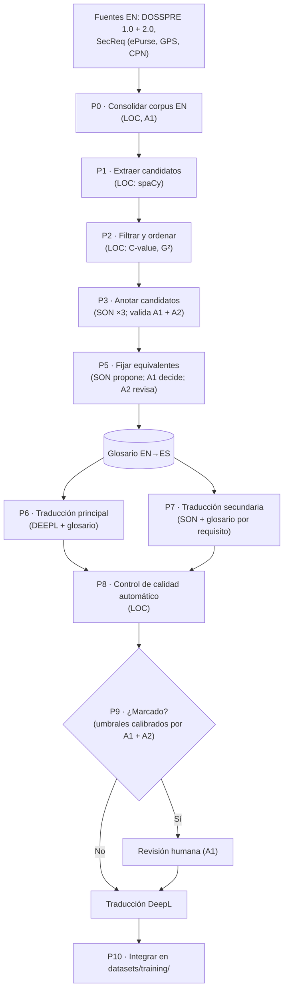

# Plan de traducción EN→ES con glosario terminológico (DOSSPRE y SecReq)

Versión 2 · 18-10-2026. Reemplaza a `PLAN_TRADUCCION_GLOSARIO.md` de la raíz (la versión 1 quedó en
`old/PLAN_TRADUCCION_GLOSARIO_v1.md`). El plan de etiquetado de subcategorías está en
[`PLAN_ETIQUETADO_SUBCATEGORIAS.md`](PLAN_ETIQUETADO_SUBCATEGORIAS.md).

> **A quién va dirigido.** A los autores de la tesis, para ejecutar el plan, y a un LLM que
> redactará la metodología. Para el LLM redactor:
>
> - Cita **solo** las fuentes de la sección "Referencias". Todas son de 2022 en adelante y
>   revisadas por pares, salvo la documentación técnica de herramientas, que se cita como tal.
> - Lo marcado **[Decisión propia]** no tiene respaldo bibliográfico: preséntalo como decisión de
>   diseño de los autores, con su razón.
> - El foco de la tesis es la **clasificación multietiqueta de requisitos de seguridad** (Security
>   y seis subcaracterísticas de ISO/IEC 25010:2023). La traducción es preparación de datos:
>   redáctala en esa proporción.
> - Fuera de alcance: verbos modales (*shall*, *must*…) y usabilidad.

---

## 1. Actores

| Código | Quién | Qué hace en este plan |
|---|---|---|
| **A1** | Autor 1 (Franco) | Coordina, ejecuta los scripts, anota la muestra de P3, decide el glosario (P5), revisa traducciones (P9). |
| **A2** | Autora 2 (coautora) | Segunda anotadora de P3, revisa el glosario (P5) y es la segunda revisora de P9. |
| **SON** | `claude-sonnet-5-5` (Claude Sonnet 5.5), por la **suscripción de Claude**, ejecutado como subagentes de Claude Code. **Sin API.** | Anota candidatos (P3), propone equivalentes (P5) y hace la traducción secundaria (P7). Nunca decide. |
| **DEEPL** | DeepL API Free (servicio externo, clave del proyecto) | Traducción principal con glosario (P6). |
| **LOC** | Modelos locales **no generativos**: spaCy (`en_core_web_trf`, `es_core_news_lg`), `wordfreq`, LaBSE, CometKiwi (`Unbabel/wmt22-cometkiwi-da`) | Extracción de candidatos, métricas y control de calidad. |
| **CC** | Claude Code (asistente de programación) | Escribe y ejecuta los scripts bajo la supervisión de A1. |

**No se usa ningún LLM local** (ni de traducción ni generativo). La laptop tiene una RTX 3050 de 4 GB
y la traducción no es el foco; se declara como limitación (Sallou et al., 2024).

**No intervienen expertos en ciberseguridad en este plan.** Los equivalentes se fijan con fuentes
terminológicas y los errores de traducción no requieren ese perfil. Los expertos intervienen en
el plan de etiquetado.

---

## 2. Flujo



El número **P4 no se usa**: era el diagnóstico de la traducción anterior y quedó fuera del flujo
(sección 4). No se renumera para no romper referencias.

---

## 3. Pasos

### P0 · Consolidar el corpus fuente en inglés

- **Quién:** LOC (script `scripts/glossary/p0_source.py`), ejecutado por A1.
- **Paso a paso:**
  1. Leer DOSSPRE 1.0 y 2.0 (cp1252, alineados por `Project ID`).
  2. Leer los tres CSV de SecReq: separar texto y etiqueta con `rsplit(';', 1)`, descartar la fila
     vacía y la de etiqueta `xyz` de GPS, guardar la especificación de origen.
  3. Reparar las comillas tipográficas corruptas de SecReq con reglas explícitas.
  4. Asignar un `Source_ID` estable y **marcar duplicados sobre el texto en inglés** (`Dup_group`),
     sin borrar filas.
  5. No se incorpora ninguna traducción previa.
- **Respaldo:** Limaylla-Lunarejo et al. (2026), traducir un corpus de requisitos para clasificarlo
  en español; Sallou et al. (2024), trazabilidad de cada dato a su origen.
- **Salida:** `datasets/interim/glossary/source_en.csv`.
- **Estado:** hecho. DOSSPRE 1 316 filas (1 283 únicas) y SecReq 510 (444 únicas: ePurse 124,
  GPS 176, CPN 210).

### P1 · Extraer candidatos a término

- **Quién:** LOC (spaCy `en_core_web_trf` 3.8.0 sobre spaCy 3.8.16), script `p1_p2_terms.py`.
- **Paso a paso:**
  1. Sintagmas nominales de 1 a 4 tokens: `(ADJ|NOUN|PROPN)* (NOUN|PROPN)` y `NOUN ADP NOUN`.
  2. Siglas: tokens en mayúsculas de 2 o más letras (un plural "MACs" cuenta como "MAC").
  3. Normalizar a lema en minúsculas (*data* se mantiene como "data", no "datum") y excluir los
     candidatos de una letra.
- **Respaldo:** Zhang et al. (2022), sintagmas nominales con spaCy para términos de requisitos;
  Palacios Palacios et al. (2025), patrones morfosintácticos nominales en español; Marciniak et al.
  (2023), candidatos con etiquetas de Universal Dependencies.
- **[Decisión propia]** `trf` en vez de `lg`, por su mejor análisis sintáctico.
- **Estado:** hecho. 4 800 candidatos.

### P2 · Filtrar y ordenar candidatos

- **Quién:** LOC (`wordfreq` 3.1.1), mismo script.
- **Paso a paso:**
  1. Conservar los candidatos con frecuencia ≥ 2; las siglas entran siempre.
  2. Especificidad: log-likelihood (G²) frente al inglés general; se descartan los de G² ≤ 0
     (salvo siglas).
  3. Ranking: media de percentiles de C-value (solo multipalabra), G² y dispersión entre
     especificaciones. La dispersión **no** filtra, porque ePurse, GPS y CPN son dominios distintos.
- **Respaldo:** Marciniak et al. (2023), C-value para ordenar candidatos; Kyröläinen y Laippala
  (2023), log-likelihood frente a un corpus de referencia; Palacios Palacios et al. (2025), filtro
  por frecuencia y especialización. `wordfreq` (Speer, 2022) se cita solo como herramienta.
- **[Decisión propia]** El umbral ≥ 2 (corpus pequeño); G² con un corpus de referencia nominal de
  10⁹ tokens, porque `wordfreq` da proporciones.
- **Estado:** hecho. 1 618 candidatos (126 siglas; 226 eliminados por G²).

### P3 · Anotar los candidatos con un LLM y validar con humanos

- **Quién:** SON anota; **A1** anota la muestra de validación completa; **A2** anota la
  submuestra; A1 calcula los acuerdos.
- **Paso a paso:**
  1. SON clasifica cada candidato con el prompt `datasets/interim/glossary/p3/prompt_v1.md`
     (hash `d9d7bd420609`): categoría (*Specific*, *Common*, *OOD*, *NE*, *NotTerm*, las de ACTER),
     si es de seguridad, subcaracterística de ISO/IEC 25010, si el límite es correcto y una
     justificación.
  2. Lotes de 90, un subagente nuevo por lote, **3 corridas independientes** y voto mayoritario
     por campo. Un script valida cada salida contra un JSON schema.
  3. A1 y A2 revisan y, si hace falta, reemplazan los 8 ejemplos *few-shot* del prompt (los redactó
     CC). Si cambian, P3 se repite.
  4. **A1** anota a ciegas los 200 candidatos de `human_sample.csv` (estratificados por categoría),
     con una guía que contiene las definiciones del prompt sin los ejemplos, de una sola vez.
  5. **A2** anota a ciegas unos 50 de esos 200, con la misma guía.
  6. Se reportan el κ de Cohen entre A1 y A2 (referencia de lo que admite la tarea) y el κ entre
     SON y A1. Si son parecidos, SON concuerda con un humano tanto como otro humano.
  7. SON **no decide**: su salida solo ordena la revisión de P5.
- **Respaldo:**
  - Rigouts Terryn (2026): los LLM anotan términos con un F1 cercano al acuerdo humano (0,59 en
    ACTER); los prompts usan la misma guía que los anotadores humanos.
  - Tran et al. (2025): extracción de términos con LLM y pocos ejemplos.
  - Ahmed et al. (2025): un solo anotador conlleva sesgo; el acuerdo LLM–humano se interpreta
    frente al acuerdo entre humanos.
  - Shah et al. (2025): dos anotadores con formación en ingeniería de software, κ entre ellos y
    comparación del LLM con su anotación.
  - Palacios Palacios et al. (2025): validación manual con κ de Cohen (0,723).
  - Sallou et al. (2024): registrar modelo, versión, fecha y prompt.
- **Registro por lote:** ID del modelo, versión de Claude Code, fecha UTC, hash del prompt,
  archivos de entrada y salida, reintentos. Las salidas se congelan.
- **Limitaciones que se declaran:** no se controlan `temperature` ni `seed` (Claude Code no los
  expone); Claude Code agrega su propio prompt de sistema; los ejemplos *few-shot* los redactó CC.
- **Estado:** SON hecho (unanimidad entre corridas: categoría 0,775; seguridad 0,950;
  subcaracterística 0,939; límite 0,909). Resultado: 496 *Specific*, 330 *Common*, 71 *NE*,
  48 *OOD*, 673 *NotTerm*; 324 de seguridad. **Pendiente:** pasos 3 a 6.

### Lista para P5 (`p3b_shortlist.py`)

- Entra un candidato si es *Specific*, si es de seguridad y no es *NotTerm*, o si es *NE*.
- **Resultado:** 661 términos (496 *Specific*, 319 de seguridad, 71 *NE*; se solapan). Los 5
  términos de seguridad clasificados como *NotTerm* no entran.
- **Pendiente (A1 + A2):** revisar los 661 o priorizar los 319 de seguridad + 71 *NE*.

### P5 · Fijar los equivalentes en español (el glosario)

- **Quién:** SON propone; **A1** decide cada equivalente con su fuente; **A2** revisa una muestra
  y **todas** las entradas sin fuente.
- **Paso a paso:**
  1. SON propone de 1 a 3 equivalentes por término (lotes de unos 30, una corrida), con tipo
     (traducción, préstamo, sigla sin traducir), fuente probable y riesgos de confusión. Prompt:
     ```text
     Eres traductor técnico EN→ES especializado en seguridad de la información. Para el término
     en inglés y sus contextos, propone de 1 a 3 equivalentes en español de España, en registro
     técnico formal, ordenados por preferencia. Para cada uno indica:
     - "es": el equivalente, en singular y en forma de lema.
     - "type": "traducción" | "préstamo" | "sigla_sin_traducir".
     - "likely_source": la fuente donde esperas que aparezca ("INCIBE", "IREB", "IATE") o
       "ninguna". Es una sugerencia que un humano verificará; no afirmes que aparece.
     - "note": ambigüedad o riesgo de confusión (p. ej. security/safety → seguridad/protección).
     No traduzcas nombres propios de productos ni de estándares. Responde solo con el JSON pedido.
     ```
  2. A1 busca cada término en las fuentes abiertas, en este orden de prioridad:
     1. ISO/IEC 25010:2023, solo para los nombres de las subcaracterísticas (Confidencialidad,
        Integridad, No repudio, Responsabilidad, Autenticidad, Resistencia).
     2. Glosario de ciberseguridad de INCIBE (2024): ataque y defensa.
     3. Glosario CPRE de IREB en español (2026): ingeniería de requisitos.
     4. IATE: el resto y desempates.
     5. NIST CSRC Glossary (inglés): solo para fijar el sentido del término en inglés.
  3. **Regla:** el equivalente queda fijado si aparece en al menos una de las fuentes 1 a 4; si dos
     discrepan, manda la de mayor prioridad y se registra. Si no aparece en ninguna, A1 decide con
     una justificación escrita y la entrada se marca `source=sin_fuente`. Los préstamos y las
     siglas que no se traducen se deciden explícitamente.
  4. A2 revisa una muestra del glosario más todas las entradas `sin_fuente`; se reporta el acuerdo.
- **Respaldo:** IREB (2024), CPRE Syllabus: usar los términos de forma consistente según un
  glosario; ISO 704:2022: principios del trabajo terminológico (concepto, término, definición).
- **[Decisión propia]** Solo fuentes de acceso abierto (las normas UNE y NTP de la serie 27000 son
  de pago y no hay acceso); la regla para términos sin fuente.
- **Salida:** `term_proposals.jsonl` (SON) y `glossary_en_es.tsv` (A1), con las columnas
  `en, es, type, source, source_ref, decided_by, date, notes`.

### P6 · Traducción principal: DeepL con glosario

- **Quién:** DEEPL, llamado por un script que ejecuta A1.
- **Paso a paso:**
  1. Subir `glossary_en_es.tsv` como glosario EN→ES (`POST /v2/glossaries`) y registrar su ID y hash.
  2. Traducir cada texto único en inglés por separado con `POST https://api-free.deepl.com/v2/translate`:
     `source_lang=EN`, `target_lang=ES`, `glossary_id`, `model_type=quality_optimized`,
     `split_sentences=nonewlines`, `preserve_formatting=true`,
     `context="Software security requirements specification (ISO/IEC 25010 security)."` (no se
     factura) y `show_billed_characters=true`.
  3. Reintentar ante 429 y 5xx; detenerse ante 456 (cuota agotada). Guardar la respuesta cruda.
- **Respaldo:**
  - Semenov et al. (2025), WMT25: evaluó EN→ES en el dominio de TI; dar la terminología mejora la
    exactitud terminológica y la calidad general.
  - Semenov et al. (2023): los diccionarios terminológicos mejoran la traducción.
  - Limaylla-Lunarejo et al. (2026): usaron DeepL; da comparabilidad con el antecedente.
  - Ouyang et al. (2024): los LLM no son deterministas; por eso el motor principal es DeepL, que
    aplica el glosario de forma nativa.
  - DeepL (2026), documentación técnica.
- **Verificado (18-10-2026, clave del proyecto):** plan Free con 1 000 000 de caracteres al mes
  (el corpus necesita unos 260 000); EN→ES admite glosario; `quality_optimized` funciona con
  glosario. DeepL flexiona la entrada del glosario (*rogue* → "malicioso" quedó como
  "maliciosos"), por eso P8 compara por lema.
- **Salida:** `translations/deepl.jsonl` (`Source_ID, es, model_type_used, glossary_id,
  glossary_hash, timestamp_utc, raw_response`).

### P7 · Traducción secundaria: Sonnet con glosario por requisito

- **Quién:** SON (subagentes), orquestado por CC.
- **Paso a paso:**
  1. Lotes de 20 requisitos; a cada requisito se le pasan solo las entradas del glosario cuyo
     término en inglés aparece en él.
  2. Una corrida para el corpus completo y 3 corridas sobre una muestra de unos 100 requisitos para
     medir la estabilidad (porcentaje de salidas idénticas y chrF++ entre corridas).
  3. Prompt:
     ```text
     Eres traductor técnico EN→ES de especificaciones de requisitos de software, con especialidad
     en seguridad de la información. Traduce cada requisito al español de España, en registro
     técnico formal.
     Reglas:
     1. Traduce de forma fiel y completa: no agregues, omitas ni reinterpretes información. No
        corrijas el requisito aunque parezca ambiguo o incorrecto.
     2. Usa OBLIGATORIAMENTE los equivalentes del glosario que acompaña a cada requisito. Ajusta
        género, número y artículos para que la oración sea gramatical, sin cambiar el término.
     3. Mantén sin traducir siglas, nombres propios de productos, protocolos y estándares, e
        identificadores, salvo que el glosario indique otra cosa.
     4. Conserva números, unidades y valores exactamente.
     5. Devuelve solo el JSON pedido: {"id", "es", "terms_used"}.
     ```
- **Para qué sirve:** no reemplaza a DeepL. Da la señal de acuerdo entre motores (P8) y una
  alternativa en la revisión (P9), como el antecedente usó dos traductores.
- **Respaldo:** Moslem et al. (2023), terminología en contexto con LLM, incluido EN→ES; Semenov
  et al. (2023), terminología entregada por frase; Semenov et al. (2025), la línea base del WMT25
  era un LLM con el glosario en el prompt.
- **Salida:** `translations/llm.jsonl`, con el mismo registro que P3.

### P8 · Control de calidad automático

- **Quién:** LOC, scripts ejecutados por A1.
- **Paso a paso:** cuatro señales por requisito sobre la traducción de DeepL.
  1. **Exactitud terminológica:** para cada entrada del glosario presente en el inglés, comprobar
     que el equivalente aparece en el español, por coincidencia exacta y por lema (spaCy
     `es_core_news_lg`). Además, consistencia del mismo término en todo el corpus.
  2. **Calidad sin referencia:** CometKiwi `Unbabel/wmt22-cometkiwi-da` (puntaje 0–1).
  3. **Acuerdo entre motores:** chrF++ (sacreBLEU) entre DeepL y SON.
  4. **Errores graves:** similitud coseno LaBSE entre el inglés y el español (umbral inicial 0,80).
- **Respaldo:**
  - Semenov et al. (2023, 2025): exactitud y consistencia terminológica se miden aparte.
  - Amrhein y Sennrich (2022): COMET es poco sensible a errores de términos y entidades.
  - Rei et al. (2022): CometKiwi, ganador de la tarea de estimación de calidad del WMT22.
  - Freitag et al. (2023): las métricas neuronales siguen siendo válidas.
  - Feng et al. (2022): LaBSE.
  - Kocmi y Federmann (2023): se descarta un LLM como juez (GEMBA-MQM) por ser caja negra.
- **[Decisión propia]** chrF++ entre motores como versión calibrada del criterio del antecedente;
  el umbral 0,80 de LaBSE.
- **Entorno de CometKiwi (verificado):** no convive con el entorno de entrenamiento. Se usa
  `C:/Users/Franco/.venvs/cometkiwi` (Python 3.12, `torch` 2.5.1 CPU, `unbabel-comet` 2.2.7,
  `setuptools<81`). Tarda unos 4 minutos para el corpus en CPU.
- **Prueba de factibilidad:** las traducciones correctas dan 0,84–0,88; *rogue* → "rogar" da 0,59;
  una omisión, 0,57; un error de término (*SQL Injection* → "SQL Inyection") solo baja a 0,816.
  Confirma a Amrhein y Sennrich (2022) y justifica la señal 1.
- **Salida:** `qc_signals.csv` (`Source_ID, term_acc, term_missing, cometkiwi, chrf_deepl_llm, labse`).

### P9 · Calibración de umbrales y revisión humana

- **Quién:** **A1 y A2** etiquetan la muestra calibrada; **A1** revisa los requisitos marcados y A2
  revisa los casos que A1 edite a mano.
- **Paso a paso:**
  1. Muestra de unos 150 requisitos (75 de DOSSPRE y 75 de SecReq), estratificada por cuartil de
     CometKiwi con **sobremuestreo del cuartil más bajo** (40 % en Q1 y 20 % en cada uno de los
     otros).
  2. A1 y A2 etiquetan cada requisito por separado como *OK*, *error menor* o *error mayor*, con una
     guía de anotación de errores por tramos (ESA). Se reporta el κ de Cohen.
  3. Para CometKiwi y chrF++ se elige el umbral que alcanza al menos 90 % de recall de errores
     mayores, ponderando por el peso de cada cuartil. Se reporta la curva de recall frente a la
     carga de revisión.
  4. Un requisito va a revisión si `term_acc < 1`, si CometKiwi o chrF++ quedan bajo su umbral o si
     LaBSE < 0,80.
  5. A1 ve el inglés, DeepL, SON y los términos que faltan, y elige DeepL, elige SON o edita. Se
     registran la decisión y el motivo.
  6. Los no marcados quedan con DeepL.
- **Respaldo:** Kocmi et al. (2024), ESA; Ahmed et al. (2025), validación humana y acuerdo entre
  anotadores; Limaylla-Lunarejo et al. (2026), revisión manual de los segmentos dudosos (aquí se
  agrega calibración y κ, que el antecedente no reporta).
- **[Decisión propia]** El 90 % de recall; el sobremuestreo del cuartil bajo.
- **Salida:** `review_decisions.csv` y las métricas de la muestra (κ, umbrales, curva).

### P10 · Integración en el pipeline de entrenamiento

- **Quién:** CC, bajo la supervisión de A1.
- **Paso a paso:**
  1. `scripts/prepare_datasets.py` lee SecReq de los CSV en inglés y DOSSPRE del original, con la
     traducción final por `Source_ID`; deja de usar opus-mt y `SecReq_es.csv`.
  2. Deduplica sobre el inglés, normalizando mayúsculas, espacios, puntuación y artículos, y deja
     `Requirement_original` y la especificación de origen completos. Después verifica que no queden
     textos idénticos en español: si quedan, también se fusionan, porque el modelo los vería como
     la misma entrada y habría fuga entre entrenamiento y evaluación. En la corrida provisional se
     fusionaron así 21 pares en DOSSPRE y 4 en SecReq, todos duplicados del original con
     diferencias mínimas en inglés. Los que tienen etiquetas contradictorias los resuelve el plan
     de etiquetado (E6, punto 7).
  3. Agrega `Translation_source` (`deepl+glossary`, `llm+glossary`, `human_edit`).
  4. Las subcategorías vienen del plan de etiquetado, sobre el inglés, y no de expresiones
     regulares sobre el español.
  5. Opcional: comparar la consistencia terminológica de opus-mt con la de la traducción final en
     DOSSPRE (sección 4).
- **Después:** reentrenar con Optuna desde cero los 4 modelos en SecReq y DOSSPRE, y BETO y
  RoBERTa-BNE en PROMISE (cambió el código del dropout). CNN y BiLSTM en PROMISE solo se repiten si
  `promise.csv` cambia (con el etiquetado nuevo, cambia).

### P11 · Registro y amenazas a la validez

| Amenaza | Mitigación | Respaldo |
|---|---|---|
| No determinismo del LLM | Salidas congeladas; 3 corridas en P3; DeepL como motor principal | Ouyang et al. (2024); Sallou et al. (2024) |
| Evolución o retiro del modelo | ID fijo, fecha y versión de Claude Code registrados | Sallou et al. (2024) |
| Prompt de sistema de Claude Code no controlado | Se declara | Sallou et al. (2024) |
| Sin LLM abierto de comparación | Se declara como limitación (GPU de 4 GB; la traducción no es el foco) | Sallou et al. (2024) |
| El LLM "normaliza" un requisito | Regla de fidelidad, QE y revisión humana | Ahmed et al. (2025) |
| Subjetividad de los revisores | Dos revisores (A1, A2), κ y guía escrita | Ahmed et al. (2025) |
| Variante del español | Español de España, por cercanía al preentrenamiento de RoBERTa-BNE | [Decisión propia] |

---

## 4. Diagnóstico preliminar (antes P4; fuera del flujo)

Antes de este plan, DOSSPRE se tradujo con `Helsinki-NLP/opus-mt-en-es` y SecReq con una herramienta
no documentada (`old/SecReq_es.csv`), sin control terminológico. Los autores consideran ese intento
metodológicamente incorrecto: **no interviene en ningún paso** y se usa solo como evidencia de por
qué hace falta el glosario.

- **Método:** alineamiento de palabras EN–ES con LaBSE, capa 6, intersección de argmax en ambas
  direcciones (Wang et al., 2022). Scripts y salidas en `old/glossary_p4/`.
- **Resultados:** 14 275 ocurrencias alineadas. Entre los términos con 2 o más ocurrencias, el
  31,5 % se tradujo de más de una forma (consistencia media 0,881). Ejemplos: *SQL injection* →
  "sql inyection"/"inyección sql"; *rogue* → "rogar"; *ham* → "jamón"; *firewall* sin traducir en
  SecReq y "cortafuegos" en DOSSPRE.
- **Uso en la tesis:** motivación del glosario. La comparación antes/después es opcional y solo en
  DOSSPRE, que es reproducible (opus-mt: Tiedemann et al., 2024).

---

## 5. Corrida provisional sin validaciones (18-10-2026)

Para tener resultados preliminares mientras se hacen las validaciones humanas, se ejecuta el flujo
con estos reemplazos. **Sus resultados son provisionales y no son los finales de la tesis.**

| Paso | En la corrida provisional |
|---|---|
| P3 | Se usa la salida de SON tal cual (sin pasos 3 a 6). |
| P5 | Equivalente = primera propuesta de SON, sin verificar fuentes (`decided_by=SON_provisional`). Alcance: los 661 términos. |
| P6 | Igual que el plan. |
| P7 | Se omite. |
| P8 | Solo exactitud terminológica, CometKiwi y LaBSE (sin chrF++). |
| P9 | Se omite: queda la traducción de DeepL. |
| P10 | Igual que el plan, con `Translation_source=deepl+glossary_provisional`. |

---

## 6. Decisiones de los autores

| Tema | Decisión |
|---|---|
| Variante de destino | Español de España (`ES`), por RoBERTa-BNE |
| LLM | Solo `claude-sonnet-5-5`, por suscripción, como subagentes de Claude Code (sin API). Se evaluaron gpt-oss-120b (Groq o local) y la API de Anthropic, y se descartaron |
| Traducciones previas | Fuera del proceso; solo como diagnóstico preliminar |
| Fuentes de P5 | Solo de acceso abierto |
| Segundo revisor de traducción | A2 (coautora) |
| Referencias | Solo de 2022 en adelante y revisadas por pares; se quitaron los preprints |
| **Pendiente** | Alcance de P5 (661 o 390); validar los ejemplos *few-shot* de P3; anotar `human_sample.csv` |

---

## 7. Referencias (solo las que respaldan decisiones)

**Antecedente**
- Limaylla-Lunarejo, M.-I., Condori-Fernández, N., Rodríguez Luaces, M., & Karras, O. (2026).
  Improving the multi-class classification of non-functional requirements in Spanish: A study of
  dataset balancing and performance. *Empirical Software Engineering, 31*, 6.
  https://doi.org/10.1007/s10664-025-10736-9

**Extracción y anotación de términos**
- Zhang, J., Chen, S., Hua, J., Niu, N., & Liu, C. (2022). Automatic terminology extraction and
  ranking for feature modeling. *IEEE 30th RE*, 51–63. https://doi.org/10.1109/RE54965.2022.00012
- Marciniak, M., Rychlik, P., & Mykowiecka, A. (2023). TermoUD – a language-independent
  terminology extraction tool. *EACL 2023 System Demonstrations*, 178–186.
  https://doi.org/10.18653/v1/2023.eacl-demo.21
- Palacios Palacios, L., Guerrero García, B., Martín Chozas, P., & Montiel Ponsoda, E. (2025).
  Legal terminology extraction in Spanish: Gold-standard generation and LLM evaluation. *RANLP
  2025*, 860–869. https://aclanthology.org/2025.ranlp-1.98/
- Kyröläinen, A.-J., & Laippala, V. (2023). Predictive keywords: Using machine learning to explain
  document characteristics. *Frontiers in Artificial Intelligence, 5*, 975729.
  https://doi.org/10.3389/frai.2022.975729
- Rigouts Terryn, A. (2026). Large language models are good term extractors: A systematic
  evaluation. *LREC 2026*, 7631–7643. https://aclanthology.org/2026.lrec-1.605/
- Tran, H. T. H., González-Gallardo, C.-E., Doucet, A., & Pollak, S. (2025). LlamATE: Automated
  terminology extraction using large-scale generative language models. *Terminology, 31*(1), 5–36.
  https://doi.org/10.1075/term.00082.tra
- Speer, R. (2022). *wordfreq* (v3.0.2) [Software]. https://doi.org/10.5281/zenodo.7199437

**Validación de anotaciones con LLM**
- Ahmed, T., Devanbu, P., Treude, C., & Pradel, M. (2025). Can LLMs replace manual annotation of
  software engineering artifacts? *MSR 2025*. https://doi.org/10.1109/MSR66628.2025.00086
- Shah, S. T. U., Hussein, M., Barcomb, A., & Moshirpour, M. (2025). From inductive to deductive:
  LLMs-based qualitative data analysis in requirements engineering. *NLP4RE'25*, CEUR-WS 3959.
  https://ceur-ws.org/Vol-3959/NLP4RE-paper2.pdf

**Traducción con terminología**
- Semenov, K., Zouhar, V., Kocmi, T., Zhang, D., Zhou, W., & Jiang, Y. E. (2023). Findings of the
  WMT 2023 shared task on machine translation with terminologies. *WMT 2023*, 663–671.
  https://doi.org/10.18653/v1/2023.wmt-1.54
- Semenov, K., Huang, X., Zouhar, V., Berger, N., Zhu, D., Oncevay, A., & Chen, P. (2025).
  Findings of the WMT25 terminology translation task. *WMT 2025*, 554–576.
  https://doi.org/10.18653/v1/2025.wmt-1.30
- Moslem, Y., Haque, R., Kelleher, J. D., & Way, A. (2023). Adaptive machine translation with large
  language models. *EAMT 2023*, 227–237. https://aclanthology.org/2023.eamt-1.22
- Ouyang, S., Zhang, J. M., Harman, M., & Wang, M. (2024). An empirical study of the
  non-determinism of ChatGPT in code generation. *ACM TOSEM*. https://doi.org/10.1145/3697010
- Tiedemann, J., et al. (2024). Democratizing neural machine translation with OPUS-MT. *Language
  Resources and Evaluation, 58*(2), 713–755. https://doi.org/10.1007/s10579-023-09704-w
- DeepL SE. (2026). *DeepL API documentation*. https://developers.deepl.com/

**Control de calidad**
- Rei, R., et al. (2022). CometKiwi: IST-Unbabel 2022 submission for the quality estimation shared
  task. *WMT 2022*, 634–645. https://aclanthology.org/2022.wmt-1.60
- Freitag, M., et al. (2023). Results of WMT23 metrics shared task. *WMT 2023*, 578–628.
  https://doi.org/10.18653/v1/2023.wmt-1.51
- Amrhein, C., & Sennrich, R. (2022). Identifying weaknesses in machine translation metrics through
  minimum Bayes risk decoding: A case study for COMET. *AACL-IJCNLP 2022*, 1125–1141.
  https://doi.org/10.18653/v1/2022.aacl-main.83
- Feng, F., Yang, Y., Cer, D., Arivazhagan, N., & Wang, W. (2022). Language-agnostic BERT sentence
  embedding. *ACL 2022*, 878–891. https://doi.org/10.18653/v1/2022.acl-long.62
- Wang, W., Chen, G., Wang, H., Han, Y., & Chen, Y. (2022). Multilingual sentence transformer as a
  multilingual word aligner. *Findings of EMNLP 2022*, 2952–2963.
  https://doi.org/10.18653/v1/2022.findings-emnlp.215
- Kocmi, T., & Federmann, C. (2023). GEMBA-MQM: Detecting translation quality error spans with
  GPT-4. *WMT 2023*, 768–775. https://doi.org/10.18653/v1/2023.wmt-1.64
- Kocmi, T., Zouhar, V., Avramidis, E., Grundkiewicz, R., Karpinska, M., Popović, M., Sachan, M., &
  Shmatova, M. (2024). Error span annotation: A balanced approach for human evaluation of machine
  translation. *WMT 2024*, 1440–1453. https://doi.org/10.18653/v1/2024.wmt-1.131

**Uso de LLM en investigación**
- Sallou, J., Durieux, T., & Panichella, A. (2024). Breaking the silence: The threats of using LLMs
  in software engineering. *ICSE-NIER 2024*. https://doi.org/10.1145/3639476.3639764

**Terminología y normas**
- Bühne, S., Glinz, M., van Loenhoud, H., & Staal, S. (2024). *CPRE Foundation Level Syllabus*
  (v3.2.0, 26-02-2024). IREB e.V. Copia en
  https://gasq.org/files/content/gasq/downloads/certification/IREB/cpre_foundationlevel_syllabus_en_v.3.2.pdf
  (el sitio de IREB ya solo ofrece la v3.3.0; si se prefiere la vigente, verificar que mantenga la
  frase sobre el uso consistente de términos).
- Glinz, M. (2026). *Glosario de terminología de ingeniería de requisitos – español* (v2.2.1,
  16-04-2026; traducción de la v2.2.0 en inglés). IREB e.V.
  https://hub.ireb.org/media/pages/resources/cpre-glossary/b9cf057b7a-1787039949/ireb_cpre_glossary_es_2.2.1.pdf
- ISO. (2022). *ISO 704:2022 Terminology work — Principles and methods*.
- ISO/IEC. (2023). *ISO/IEC 25010:2023 Product quality model*.
- INCIBE. (2024). *Glosario de términos de ciberseguridad*.
- Comisión Europea. *IATE*. https://iate.europa.eu (citar con fecha de consulta).
- NIST. *CSRC Glossary*. https://csrc.nist.gov/glossary (solo para el sentido en inglés).
