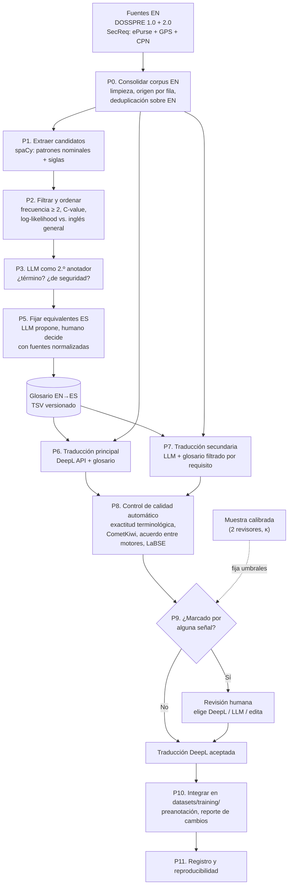

# Plan de traducción EN→ES con glosario terminológico (DOSSPRE y SecReq)

> **Para el LLM redactor.** Este documento no es la sección de metodología: es el insumo para
> redactarla. Describe qué se va a hacer, en qué orden, con qué fuente se justifica cada paso y,
> cuando interviene IA, con qué configuración, prompt, entradas y salidas. Al redactar:
>
> - Cita solo las fuentes de la sección final, que son de 2022 en adelante (restricción de la tesis).
>   La documentación técnica de herramientas se cita como tal, no como evidencia científica.
> - Lo marcado como **[Decisión propia]** no tiene respaldo bibliográfico. Preséntalo como decisión
>   de diseño del autor, con su razón, no como algo que dice la literatura.
> - Lo marcado como **[Verificar]** no se pudo confirmar. No lo afirmes sin que el autor lo confirme.
> - El foco de la tesis es la **clasificación multietiqueta de requisitos de seguridad** (Security
>   y seis subcategorías de ISO/IEC 25010). La traducción y el glosario son preparación de datos,
>   no el objeto de estudio. Redáctalo en esa proporción.
> - El tratamiento de verbos modales (*shall*, *must*…) queda **fuera de alcance** por decisión del
>   autor: no lo incluyas como paso ni como regla del glosario.

## Contexto que el redactor debe conocer

- Los clasificadores (CNN, BiLSTM, BETO, RoBERTa-BNE) se entrenan en español; BETO y RoBERTa-BNE
  son modelos preentrenados en español. Por eso los corpus en inglés deben traducirse.
- **DOSSPRE** (1 316 filas; 1 283 textos únicos en inglés) se tradujo antes con
  `Helsinki-NLP/opus-mt-en-es`, sin glosario. Tiene errores terminológicos visibles, por ejemplo
  *"SQL Injection"* → *"SQL Inyection"*.
- **SecReq** se forma con tres especificaciones: ePurse-selective (124), GPS (176 válidas) y
  CPN (210) = 510 filas, 444 textos únicos en inglés. La traducción española existente
  (`old/SecReq_es.csv`) no tiene registrada la herramienta que la produjo, perdió el texto en
  inglés y la especificación de origen. Coincide fila a fila con los tres CSV en inglés, en orden
  ePurse → GPS → CPN, así que se puede realinear.
- El pipeline actual deduplica sobre el texto **en español**. Como la traducción colapsa textos
  distintos, se pierden filas: SecReq 444 → 439 y DOSSPRE 1 283 → 1 279.
- En SecReq (y PROMISE) las subcategorías se preanotan con expresiones regulares sobre el texto en
  español. Cambiar la traducción cambia esas preanotaciones.
- **Variante de destino: español de España.** **[Decisión propia]** RoBERTa-BNE se preentrenó
  con el corpus de la Biblioteca Nacional de España, así que se traduce a la variante más cercana
  a sus datos de preentrenamiento. En terminología de seguridad, las diferencias con el español
  latinoamericano son menores.
- **Cómo se ejecutan los LLM:** como **subagentes de Claude Code** con el modelo
  `claude-sonnet-5-5` (Claude Sonnet 5.5), no a través de la API. En cada paso con LLM se detalla
  qué implica esto para la configuración y el registro.
- **Antecedente directo:** Limaylla-Lunarejo et al. (2026) tradujeron PROMISE_exp con Google
  Translate y DeepL, midieron la similitud coseno entre ambas traducciones (word2vec SBWCE) y
  revisaron a mano las que tenían similitud < 0,97. **No usaron glosario.** Ellos mismos reconocen
  sesgos del revisor y baja replicabilidad. Este plan se presenta como extensión de ese
  procedimiento: agrega control terminológico y un control de calidad calibrado.

## Diagrama de flujo



---

## P0. Consolidar el corpus fuente en inglés

**Qué se hace**
1. Leer `DOSSPRE 1.0Original.csv` y `2.0Binary.csv` como hoy (cp1252, alineados por `Project ID`).
2. Leer `SecReq/{ePurse-selective,GPS,CPN}.csv`:
   - Codificación cp1252, sin cabecera.
   - Separar texto y etiqueta con `rsplit(';', 1)`.
   - Descartar la fila en blanco y la fila con etiqueta `xyz` de GPS.
   - Guardar la especificación de origen en una columna.
3. Limpiar espacios y comillas. Asignar un `Source_ID` estable por fila.
4. **Deduplicar sobre el texto en inglés**, no sobre el español.
5. No se usa ninguna traducción previa: el proceso parte solo del inglés (ver "Diagnóstico
   preliminar").

**Fuentes**
- Limaylla-Lunarejo et al. (2026): traducir un corpus de requisitos para clasificar en español.
- Sallou et al. (2024): trazabilidad, es decir, vincular cada salida con su entrada y su configuración.

**En consecuencia**
- El corpus en inglés pasa a ser la referencia, y cada traducción es un atributo de cada fila.
- `Requirement_original` deja de estar vacío en SecReq.

**Salida**
- `datasets/interim/source_en.csv`, con las columnas `Source_ID, Dataset, Spec, Requirement_en, label, ...`.

---

## P1. Extraer candidatos a término

**Qué se hace**
1. Analizar `Requirement_en` con spaCy y obtener sintagmas nominales de 1 a 4 tokens con estos patrones:
   - `(ADJ|NOUN|PROPN)* (NOUN|PROPN)`
   - `NOUN ADP NOUN` (p. ej. *denial of service*, *point of sale*)
2. Agregar las siglas, es decir tokens en mayúsculas de 2 o más letras (CNG, CEP, MAC, XSS).
3. Normalizar a lema y minúsculas para contar frecuencias, guardando la forma más frecuente.

**Fuentes**
- Zhang et al. (2022): extraen términos de requisitos como sintagmas nominales con spaCy.
- Palacios Palacios et al. (2025): candidatos por patrones morfosintácticos nominales.
- Marciniak et al. (2023): candidatos con etiquetas POS y dependencias de Universal Dependencies.

**En consecuencia**
- Se usan sintagmas nominales y no "todas las palabras" ni "solo sustantivos sueltos", porque
  los términos de dominio suelen ser multipalabra.

**IA usada: spaCy (modelo estadístico de NLP)**
- **Configuración:** `en_core_web_trf` (o `en_core_web_lg` si no hay GPU). Componentes: tagger,
  parser y lemmatizer. Registrar la versión exacta del paquete y del modelo.
- **Entrada:** `Requirement_en`.
- **Salida:** `datasets/interim/glossary/candidates_raw.csv`, con las columnas
  `term, lemma, pattern, freq, n_specs, example_ids`.
- **Por qué spaCy y no otra cosa:**
  - Es la herramienta que usa el antecedente en ingeniería de requisitos (Zhang et al., 2022).
  - Es determinista, gratuita y reproducible.
  - Un LLM como extractor único sería menos reproducible (ver P3).
  - **[Decisión propia]** `trf` frente a `lg`: mejor análisis sintáctico. Si se usa `lg`, se dice.

---

## P2. Filtrar y ordenar candidatos

**Qué se hace**
1. **Umbral:** conservar los candidatos con frecuencia ≥ 2. Las siglas entran siempre.
2. **Ranking de términos multipalabra:** C-value.
3. **Especificidad de dominio:** log-likelihood (G²) entre la frecuencia en el corpus y la
   frecuencia en inglés general. Para términos de una palabra es el criterio principal de ranking.
4. **Dispersión** (cuántos requisitos o especificaciones distintas contienen el término): **solo
   como rasgo de ranking, no como filtro**. ePurse, GPS y CPN son dominios distintos, y un filtro
   de dispersión eliminaría justo los términos más especializados.

**Fuentes**
- Marciniak et al. (2023): usa C-value para ordenar candidatos y señala que muchos términos son de
  muy baja frecuencia (76 % de hápax en GENIA).
- Zhang (2022), Banerjee et al. (2024) y Tran et al. (2026): C-value sigue en uso como componente o
  línea base.
- Kyröläinen & Laippala (2023): log-likelihood frente a un corpus de referencia.
- Palacios Palacios et al. (2025): filtran por frecuencia y por grado de especialización frente a
  recursos de referencia.
- Speer (2022), `wordfreq`: se cita solo como herramienta que aporta las frecuencias del inglés
  general, no como método.

**[Decisión propia]**
- El valor ≥ 2. La literatura de 2022 en adelante respalda tener un umbral, no ese número. Se
  justifica por el tamaño pequeño de los corpus (unos 1 700 textos): un umbral mayor perdería
  términos de seguridad poco frecuentes.
- El corte final del ranking (top-N o un percentil) se fija viendo la distribución, y se reporta.

**IA usada:** ninguna. Son cálculos estadísticos.

**Salida**
- `candidates_ranked.csv`, con `cvalue, g2, dispersion` y un `rank` combinado.

---

## P3. LLM como segundo anotador de candidatos

**Qué se hace**
1. Un LLM clasifica cada candidato: ¿es término? ¿de qué tipo? ¿es relevante para seguridad? ¿qué
   subcategoría ISO/IEC 25010?
2. El autor anota una muestra de 200 candidatos (`human_sample.csv`, estratificada por categoría):
   - a ciegas, sin ver las etiquetas del LLM;
   - con una guía escrita que contiene las mismas definiciones del prompt, sin los ejemplos
     *few-shot*;
   - de una sola vez, sin corregir después de comparar con el LLM.
3. Un segundo anotador, con formación en ingeniería de software, anota a ciegas una submuestra de
   unos 50 de esos candidatos, con la misma guía.
4. Se reportan dos acuerdos con κ de Cohen:
   - entre los dos humanos, sobre la submuestra: es la referencia de cuánto acuerdo admite la tarea;
   - entre el LLM y el autor, sobre los 200.
   Si el segundo es parecido al primero, el LLM concuerda con un humano tanto como otro humano. Como
   referencia externa, el acuerdo entre humanos en ACTER es de 0,59 de F1 (Rigouts Terryn, 2026).
5. El LLM **no decide**: prioriza la revisión humana.

**Fuentes**
- Rigouts Terryn (2026): los LLM son buenos extractores de términos, con un F1 cercano al acuerdo
  humano, y muchos "errores" son decisiones de límite defendibles.
- Tran et al. (2025, LlamATE) y Banerjee et al. (2024): LLM con pocos ejemplos (few-shot) para
  extraer términos.
- Palacios Palacios et al. (2025): validación manual con κ de Cohen entre validadores (0,723).
- Ahmed et al. (2025): un solo anotador conlleva riesgo de sesgo; el acuerdo entre el LLM y los
  humanos se interpreta frente al acuerdo entre humanos.
- Shah et al. (2025): dos analistas no expertos (formación en ingeniería de software), κ entre ellos
  y comparación del LLM con su anotación.
- Sallou et al. (2024): reportar la configuración (modelo, versión, fecha, prompt).

**En consecuencia**
- El LLM se usa como segundo anotador y no como extractor único, para conservar la
  reproducibilidad de P1 y P2.

**IA usada: LLM (subagente de Claude Code)**
- **Modelo:** `claude-sonnet-5-5` (Claude Sonnet 5.5, Anthropic), ejecutado como subagente de
  Claude Code. Es el mismo modelo en todos los pasos con LLM (P3, P5 y P7).
- **Modo de ejecución (común a P3, P5 y P7):**
  - Un script divide la entrada en archivos de lote (`batch_###.jsonl`).
  - Un agente orquestador lanza un subagente por lote. A cada uno le da el prompt de este documento,
    la ruta del archivo de entrada y la ruta del archivo de salida.
  - Cada subagente lee su lote y escribe la salida en JSONL.
  - Un script valida cada línea contra el JSON schema. Los lotes con líneas inválidas o faltantes se
    vuelven a ejecutar, y el reintento se registra.
- **Parámetros:** en este modo no se controlan `temperature`, `top_p` ni `seed`. Claude Code no los
  expone, y los modelos Claude 5.x tampoco aceptan valores distintos del predeterminado. El
  no determinismo se mitiga así:
  - Las salidas se congelan.
  - Se hacen corridas repetidas y se reporta el acuerdo entre ellas.
  - La decisión final es humana.
  - El esfuerzo de razonamiento del subagente se deja en el predeterminado y se registra.
- **Qué se registra por lote:**
  - ID del modelo y versión de Claude Code (`claude --version`).
  - Fecha UTC.
  - Versión (hash) del prompt.
  - Archivo de entrada y archivo de salida.
  - Reintentos.
- **Limitación que se declara:** Claude Code agrega su propio prompt de sistema, que el autor no
  controla. El prompt de este documento va como instrucción de la tarea del subagente.
- **Por qué subagentes y no la API:**
  - No hay clave de API configurada.
  - El volumen es pequeño (unos 1 700 requisitos y algunos cientos de términos).
  - La reproducibilidad no depende de volver a ejecutar, sino de congelar y publicar las salidas.
- **Por qué Sonnet 5.5 y no Opus 5.5:**
  - Las tareas son acotadas: clasificar candidatos, proponer equivalentes y traducir oraciones
    cortas con glosario.
  - Inglés→español es un par de alto rendimiento (Kocmi et al., 2024).
  - **[Decisión propia]** Se considera suficiente y más económico.
- **Lotes y corridas en P3:**
  - Lotes de 50 candidatos.
  - 3 corridas independientes, cada una con subagentes nuevos, y voto mayoritario por campo.
  - Se reporta el porcentaje de acuerdo entre corridas.
- **Entrada (por lote, JSON):**
  ```json
  [{"cand_id": "c0123", "term": "card issuer", "freq": 14,
    "contexts": ["The card issuer and the CEP card share a secret key ...",
                 "On-line authentication must take place between the card issuer and ..."]}]
  ```
- **Prompt de sistema:**
  ```text
  Eres terminólogo especializado en seguridad de la información e ingeniería de requisitos.
  Recibirás candidatos a término extraídos automáticamente de requisitos de software en inglés,
  cada uno con hasta dos oraciones de contexto. Para cada candidato decide:

  1. category: uno de
     - "Specific": término propio del dominio, que un lego no conocería.
     - "Common": término del dominio que también usa el público general.
     - "OOD": término técnico de otro dominio.
     - "NE": nombre propio (producto, organización, estándar).
     - "NotTerm": no es un término (expresión general, fragmento mal segmentado).
  2. is_security_term: true si el concepto pertenece a la seguridad de la información.
  3. iso25010_subchar: la subcaracterística de seguridad de ISO/IEC 25010:2023 a la que más se
     asocia, o "none". Definiciones:
     - Confidentiality: los datos solo son accesibles para quienes están autorizados.
     - Integrity: se impide el acceso o la modificación no autorizados de datos o programas.
     - Non_repudiation: se puede demostrar que acciones o eventos ocurrieron, de modo que no puedan
       negarse después.
     - Accountability: las acciones de una entidad se pueden rastrear de forma única hasta ella.
     - Authenticity: se puede demostrar que un sujeto o recurso es quien dice ser.
     - Resistance: el sistema sigue operando mientras está bajo ataque de un actor malicioso.
  4. boundary_ok: false si el candidato está cortado o le sobran palabras. En ese caso, propone la
     forma correcta en "suggested_form".
  5. rationale: una oración que justifique la decisión.

  No inventes información fuera de los contextos dados. Responde solo con el JSON pedido.
  ```
  Se añaden 5 a 10 ejemplos resueltos (positivos y negativos) tomados del propio corpus y anotados
  por el autor.
- **Salida (schema):**
  ```json
  {"cand_id": "c0123", "category": "Specific", "is_security_term": true,
   "iso25010_subchar": "Authenticity", "boundary_ok": true, "suggested_form": null,
   "rationale": "..."}
  ```
  Archivo: `candidates_llm.jsonl`.
- **Por qué un LLM y no solo métricas estadísticas:**
  - C-value y G² no distinguen un término de seguridad de un término de otro dominio, y fallan con
    términos de baja frecuencia.
  - La literatura de 2024 a 2026 muestra que un LLM con pocos ejemplos rinde cerca de un anotador
    humano.
  - Por qué no un modelo supervisado: no hay datos anotados de términos de seguridad en requisitos
    para entrenarlo.
  - No se incluye un LLM abierto como línea base. No hay GPU suficiente, y la traducción es la
    preparación de los datos, no el objeto de estudio. Sallou et al. (2024) recomiendan comparar
    modelos abiertos y cerrados, así que se declara como limitación.

---

## Diagnóstico preliminar (antes P4; fuera del flujo)

Antes de este plan, DOSSPRE se tradujo con `Helsinki-NLP/opus-mt-en-es` y SecReq con una
herramienta no documentada (`old/SecReq_es.csv`), las dos sin control terminológico. Ese intento
se considera metodológicamente incorrecto y **no interviene en ningún paso del proceso nuevo**: no
se usa para elegir términos ni para entrenar. Se conserva solo como evidencia de por qué hace falta
el glosario. El número P4 queda sin usar para no renumerar los pasos siguientes.

**Qué se hizo**
- Se alinearon palabras EN–ES entre el inglés y esas traducciones (LaBSE) y se contó cuántas
  traducciones distintas recibió cada candidato de P2.
- Resultados en "Estado de ejecución". Scripts y salidas en `old/glossary_p4/`.

**Cómo se usa en la tesis**
- Como motivación: una traducción automática sin glosario produce inconsistencias terminológicas
  medibles (Semenov et al., 2023, 2025; Amrhein & Sennrich, 2022, sobre por qué COMET no las
  detecta).
- Comparación de antes y después **opcional y solo en DOSSPRE**, que es reproducible. SecReq no se
  compara porque no se sabe cómo se tradujo.

---

## P5. Fijar los equivalentes en español (construir el glosario)

**Qué se hace**
1. Tomar los candidatos que pasan P2 y P3. Se espera un glosario de 150 a 300 entradas.
2. Para cada término, un LLM propone de 1 a 3 equivalentes en español con una justificación.
3. El autor decide el equivalente final contrastándolo con fuentes de acceso abierto, en este
   orden de prioridad. Las normas UNE y NTP de la serie ISO/IEC 27000 no se usan porque son de pago
   y no hay acceso a ellas.
   1. ISO/IEC 25010:2023, solo para los nombres de las subcaracterísticas de seguridad
      (Confidencialidad, Integridad, No repudio, Responsabilidad, Autenticidad, Resistencia).
   2. Glosario de ciberseguridad de INCIBE (2024), para términos de ataque y defensa.
   3. Glosario CPRE de IREB en español (2026), para la terminología de ingeniería de requisitos.
   4. IATE, para el resto y para desempatar.
   5. NIST CSRC Glossary (inglés), solo para fijar el **sentido** del término en inglés.
4. **Regla:**
   - Un equivalente queda fijado si aparece en al menos una de las fuentes 1 a 4. Si dos fuentes
     discrepan, manda la de mayor prioridad y la discrepancia se registra.
   - **Términos sin fuente.** Si no aparece en ninguna (p. ej. términos propios del dominio, como
     *card issuer* o *CEP card*), decide el autor con una justificación escrita y la entrada se marca
     `source=sin_fuente`. **[Decisión propia]**
   - Los préstamos (p. ej. *hash*, *token*) y las siglas que no se traducen (SQL, XSS, MAC) se
     deciden explícitamente y se registran.
5. Un segundo revisor valida una muestra del glosario, que incluye **todas** las entradas
   `sin_fuente`, y se reporta el acuerdo.

**Fuentes**
- IREB (2024), CPRE Syllabus 3.2: usar los términos de forma consistente, según el glosario, y que
  su uso sea obligatorio.
- ISO 704:2022: principios del trabajo terminológico (concepto, término y definición).
- Las fuentes normalizadas listadas arriba.

**En consecuencia**
- Cada entrada del glosario es trazable a una fuente y a una persona que decidió.

**IA usada: LLM (propuesta de equivalentes)**
- **Modelo y ejecución:** `claude-sonnet-5-5` como subagente, con el mismo modo de ejecución y
  registro de P3. Una sola corrida, en lotes de unos 30 términos, porque la decisión final es humana.
- **Entrada:** `{"term": "card issuer", "category": "Specific", "contexts": [...], "subchar": "Authenticity"}`.
- **Prompt de sistema:**
  ```text
  Eres traductor técnico EN→ES especializado en seguridad de la información y en normas ISO/IEC
  de la serie 27000. Para el término en inglés y sus contextos, propone de 1 a 3 equivalentes en
  español de España, en registro técnico formal, ordenados por preferencia. Para cada uno indica:
  - "es": el equivalente, en singular y en forma de lema.
  - "type": "traducción" | "préstamo" | "sigla_sin_traducir".
  - "likely_source": la fuente terminológica donde esperas que aparezca (p. ej. "INCIBE",
    "IREB", "IATE") o "ninguna". No afirmes que aparece; es una sugerencia que un humano verificará.
  - "note": ambigüedad o riesgo de confusión (p. ej. security/safety → seguridad/protección).
  No traduzcas nombres propios de productos ni de estándares. Responde solo con el JSON pedido.
  ```
- **Salida:** `term_proposals.jsonl`. El archivo final, escrito por el humano, es
  `datasets/interim/glossary/glossary_en_es.tsv`, con las columnas
  `en, es, type, source, source_ref, decided_by, date, notes`.
- **Por qué un LLM aquí:** acelera la búsqueda de candidatos y de ambigüedades. Por qué no dejarle
  la decisión final: los LLM pueden inventar equivalentes o fuentes. Por eso la columna `source` la
  completa siempre un humano.

---

## P6. Traducción principal: DeepL API con glosario

**Qué se hace**
1. Subir el glosario a DeepL como glosario EN→ES.
2. Traducir cada requisito de forma individual.

**Fuentes**
- Semenov et al. (2025), WMT25 Terminology Task: evaluó justo inglés→español en el dominio de TI.
  Dar la terminología mejora la exactitud terminológica y la calidad general.
- Semenov et al. (2023): los diccionarios terminológicos mejoran la traducción.
- Kocmi et al. (2024): inglés→español es un par de alto rendimiento para los sistemas actuales. Por
  eso lo que más aporta es el control terminológico, no el cambio de motor.
- Limaylla-Lunarejo et al. (2026): usaron DeepL, lo que da comparabilidad con el antecedente.
- DeepL Developer Docs: parámetros y límites (documentación técnica).

**En consecuencia**
- DeepL es el motor principal porque aplica el glosario de forma nativa y determinista, a diferencia
  de un LLM que lo recibe en el prompt.

**IA usada: DeepL (traducción automática neuronal comercial)**
- **Configuración:**
  - Endpoint `POST https://api-free.deepl.com/v2/translate`, con la clave `DEEPL_AUTH_KEY` leída del
    `.env` del proyecto.
  - `source_lang=EN` (obligatorio con glosario) y `target_lang=ES` (español de España), con un
    glosario EN→ES.
  - `glossary_id=<id>`.
  - `model_type=quality_optimized`. Registrar el campo `model_type_used` de la respuesta.
  - `split_sentences=nonewlines`: un requisito, un segmento.
  - `preserve_formatting=true`.
  - `context="Software security requirements specification (ISO/IEC 25010 security)."`. Este texto
    no se factura.
  - `show_billed_characters=true`.
  - Reintentos ante errores 429 y 5xx. Detenerse ante el 456 (cuota agotada).
- **Costo:** unos 1 730 textos × ~150 caracteres ≈ 260 mil caracteres. Cabe en el plan gratuito:
  la clave del proyecto es Free, con un límite de 1 000 000 de caracteres al mes (verificado con
  `GET /v2/usage` el 18-10-2026).
- **Verificado el 18-10-2026 con la clave del proyecto:** el par EN→ES admite glosario,
  `target_lang=ES` es válido, y `model_type=quality_optimized` funciona con glosario en el plan Free.
  DeepL flexiona la entrada del glosario (*rogue* → "malicioso" quedó como "maliciosos"), por eso
  P8 necesita la comprobación por lema.
- **Entrada:** `Requirement_en` por `Source_ID`.
- **Salida:** `translations/deepl.jsonl`, con los campos
  `Source_ID, es, model_type_used, glossary_id, glossary_hash, timestamp_utc, raw_response`.
- **Por qué DeepL y no otro:**
  - opus-mt no admite glosario y es el que produjo los errores del diagnóstico preliminar.
  - Google Translate (API) admite glosario, pero no aporta frente a DeepL y no hay clave configurada.
  - Un LLM queda como motor secundario por su no determinismo.

---

## P7. Traducción secundaria: LLM con glosario filtrado por requisito

**Qué se hace**
1. Traducir el mismo corpus con un LLM.
2. A cada requisito se le pasan solo las entradas del glosario cuyo término en inglés aparece en él.
3. Esta traducción no reemplaza a DeepL: sirve para **medir el acuerdo entre motores** (P8) y como
   alternativa en la revisión humana (P9).

**Fuentes**
- Moslem et al. (2023, EAMT): aprendizaje en contexto con terminología, incluido EN→ES.
- Moslem et al. (2023, WMT): integrar terminología de dominio con LLM.
- Bogoychev & Chen (2023): traducción con conciencia terminológica mediante prompting.
- Semenov et al. (2023): en la tarea de terminología del WMT23 la terminología se entrega por
  frase, solo con las entradas que aparecen en ella.
- Semenov et al. (2025): la línea base del WMT25 era un LLM con el glosario en el prompt.

**IA usada: LLM (subagente de Claude Code)**
- **Modelo:** `claude-sonnet-5-5`, como subagente, con el modo de ejecución y el registro de P3.
- **Lotes y corridas:**
  - Lotes de 20 requisitos con su ID.
  - 3 ejemplos (few-shot) revisados por un humano, incluidos en el prompt.
  - Una sola corrida para el corpus completo.
  - Para medir la estabilidad, 3 corridas sobre una muestra de unos 100 requisitos. Se reportan el
    porcentaje de salidas idénticas y el chrF++ entre corridas.
- No se usa un modelo abierto de traducción como línea base: por falta de GPU y porque no es el
  foco de la tesis. Se declara como limitación.
- **Prompt de sistema:**
  ```text
  Eres traductor técnico EN→ES de especificaciones de requisitos de software, con especialidad en
  seguridad de la información. Traduce cada requisito al español de España, en registro técnico
  formal.

  Reglas:
  1. Traduce de forma fiel y completa: no agregues, omitas ni reinterpretes información. No
     corrijas el requisito aunque parezca ambiguo o incorrecto.
  2. Usa OBLIGATORIAMENTE los equivalentes del glosario que acompaña a cada requisito. Ajusta género,
     número y artículos para que la oración sea gramatical, sin cambiar el término.
  3. Mantén sin traducir las siglas, los nombres propios de productos, protocolos y estándares, y
     los identificadores, salvo que el glosario indique otra cosa.
  4. Conserva números, unidades y valores exactamente.
  5. Devuelve solo el JSON pedido.
  ```
- **Entrada (por requisito):**
  ```json
  {"id": "secreq_ePurse_017",
   "en": "The card issuer and the CEP card share a secret key to generate and verify MACs",
   "glossary": [{"en": "card issuer", "es": "emisor de la tarjeta"},
                {"en": "secret key", "es": "clave secreta"},
                {"en": "MAC", "es": "MAC"}]}
  ```
- **Salida:**
  ```json
  {"id": "secreq_ePurse_017", "es": "...",
   "terms_used": [{"en": "card issuer", "es": "emisor de la tarjeta"}]}
  ```
  Archivo: `translations/llm.jsonl`. Por cada lote se registran el ID del modelo, la versión de
  Claude Code, la fecha UTC, la versión del prompt, el hash del glosario y los archivos de entrada y
  salida.
- **Por qué un segundo motor:**
  - El antecedente usó dos traductores para detectar segmentos problemáticos. Aquí se mantiene esa
    idea.
  - Un LLM es más distinto de DeepL que Google Translate, así que su desacuerdo es más informativo.
  - Además, maneja mejor la flexión de los términos del glosario en español.
- **Por qué no un LLM como motor principal:**
  - Ejecutado como subagente, no hay control de muestreo y la salida no es determinista
    (Ouyang et al., 2024).
  - Los modelos se retiran con el tiempo.
  - DeepL aplica el glosario de forma nativa.

---

## P8. Control de calidad automático

Se calculan cuatro señales por requisito sobre la traducción de DeepL.

1. **Exactitud terminológica.**
   - Para cada entrada del glosario cuyo término en inglés aparece en el original, comprobar que su
     equivalente aparece en la traducción.
   - Hacer dos comprobaciones: coincidencia exacta y coincidencia por lema en minúsculas (spaCy
     `es_core_news_lg`), como en el algoritmo del WMT25.
   - Además, medir la **consistencia** en todo el corpus: el mismo término en inglés debe traducirse
     siempre igual.
   - Fuentes: Semenov et al. (2023, 2025); Amrhein & Sennrich (2022).
2. **Estimación de calidad sin referencia (QE):** CometKiwi.
   - Fuentes: Rei et al. (2022, 2023); Freitag et al. (2023, 2024), que muestran que las métricas
     neuronales siguen siendo válidas.
3. **Acuerdo entre motores:** chrF++ (sacreBLEU) entre la traducción de DeepL y la del LLM.
   - **[Decisión propia]** Es la versión calibrada del criterio del antecedente (similitud entre dos
     traductores).
4. **Filtro de errores graves:** similitud coseno LaBSE entre el inglés y el español, para detectar
   omisiones o texto sin traducir.
   - Fuente: Feng et al. (2022).

**IA usada**

- **CometKiwi**
  - Modelo: `Unbabel/wmt22-cometkiwi-da`. Licencia CC BY-NC-SA 4.0, de uso académico; requiere
    aceptar las condiciones en Hugging Face.
  - No se usa la versión XL (`wmt23-cometkiwi-da-xl`) porque necesita unos 15 GB de GPU.
    `wmt22-cometkiwi-da` (unos 560 millones de parámetros) puede correr en la GPU disponible o en
    CPU. Con unos 1 700 requisitos, el tiempo en CPU es aceptable.
  - **Entorno (verificado el 18-10-2026):** `unbabel-comet` 2.2.7 no convive con el entorno de
    entrenamiento (exige numpy < 2, pandas < 3 y transformers < 5, sin versiones para Python 3.14).
    Se usa un entorno aparte con Python 3.12, `torch` 2.5.1 para CPU y `setuptools<81`, en
    `C:/Users/Franco/.venvs/cometkiwi` (ruta corta por el límite de 260 caracteres de Windows).
  - **Prueba de factibilidad (CPU):** unos 0,15 s por par, es decir, unos 4 minutos para el corpus.
    Con pares tomados de la traducción previa:
    - las traducciones correctas dan 0,84–0,88;
    - un error grave (*rogue* → "rogar") da 0,59 y una omisión da 0,57;
    - un error de término (*SQL Injection* → "SQL Inyection") solo baja de 0,876 a 0,816.
    Confirma lo de Amrhein & Sennrich (2022): CometKiwi detecta errores graves y omisiones, pero es
    poco sensible a los errores de término. Por eso la exactitud terminológica se mide aparte (señal 1).
  - Comando: `comet-score -s src_en.txt -t mt_es.txt --model Unbabel/wmt22-cometkiwi-da`
    (añadir `--gpus 0` para usar CPU).
  - Entrada: pares inglés y traducción. Salida: un puntaje de 0 a 1 (mayor es mejor) por requisito.
  - Por qué este y no otro:
    - No necesita traducción de referencia, que no existe.
    - Ganó la tarea de estimación de calidad del WMT22 (Rei et al., 2022). Las versiones que ganaron
      el WMT23 son las XL/XXL (Rei et al., 2023), descartadas por memoria.
    - Corre en una GPU T4.
  - MetricX-24 (`google/metricx-24-hybrid-large-v2p6`, Apache-2.0) queda como segunda métrica
    opcional si hace falta una licencia abierta.
  - Por qué no un LLM como juez (GEMBA-MQM): sus propios autores lo desaconsejan como evidencia
    académica por ser una caja negra (Kocmi & Federmann, 2023).
- **LaBSE**
  - Modelo: `sentence-transformers/LaBSE`.
  - Entrada: el inglés y el español. Salida: la similitud coseno.
  - Solo se usa como filtro grueso. **[Decisión propia]** El umbral inicial es 0,80 y se ajusta
    viendo la distribución.
  - Por qué no como señal principal: detecta mal los errores de terminología.
- **Por qué no la similitud word2vec del antecedente:**
  - Promediar vectores de palabras ignora el orden y la negación.
  - Compara dos traducciones automáticas entre sí, nunca con el original.
  - Su umbral de 0,97 no está calibrado.
  - Se puede calcular igual, solo para compararse con el antecedente.

**Salida**
- `qc_signals.csv`, con las columnas `Source_ID, term_acc, term_missing, cometkiwi, chrf_deepl_llm, labse`.

---

## P9. Calibración de umbrales y revisión humana

**Qué se hace**
1. **Muestra calibrada:**
   - Unos 150 requisitos (75 de DOSSPRE y 75 de SecReq), estratificados por cuartiles de CometKiwi.
   - Se **sobremuestrea el cuartil más bajo** (p. ej. 40 % de la muestra en Q1 y 20 % en cada uno de
     los otros), porque ahí se concentran los errores mayores y con pocos casos el umbral sale con
     mucho ruido. El recall se calcula ponderando por el peso de cada cuartil. **[Decisión propia]**
   - Dos revisores etiquetan cada uno como *OK*, *error menor* o *error mayor*, con una guía de
     anotación de errores por tramos (estilo ESA/MQM).
   - Se reporta el κ de Cohen.
2. **Umbrales:**
   - Para CometKiwi y chrF++, elegir el umbral que alcance al menos 90 % de recall de errores
     mayores en la muestra.
   - Reportar la curva de recall frente a la carga de revisión.
   - **[Decisión propia]** El 90 % de recall.
3. **Regla de envío a revisión.** Un requisito va a revisión humana si cumple cualquiera de estas
   condiciones:
   - `term_acc < 1`
   - CometKiwi bajo el umbral
   - chrF++ bajo el umbral
   - LaBSE < 0,80
4. **Revisión:** el revisor ve el inglés, la traducción de DeepL, la del LLM y los términos que
   faltan. Elige DeepL, elige el LLM o edita. Se registra la decisión y el motivo.
5. Los requisitos no marcados quedan con la traducción de DeepL.

**Fuentes**
- Kocmi et al. (2024): anotación de errores por tramos (ESA).
- Ahmed et al. (2025): validación humana y acuerdo entre anotadores.
- Limaylla-Lunarejo et al. (2026): revisión manual de los segmentos dudosos. Aquí se agrega la
  calibración y el acuerdo entre revisores, que el antecedente no reporta.

**IA usada:** ninguna. Es una decisión humana.

**Salida**
- `review_decisions.csv`, con las columnas `Source_ID, flagged_by, choice, final_es, reviewer, reason`.
- Las métricas de la muestra calibrada (κ, umbrales y curva).

---

## P10. Integración en el pipeline de entrenamiento

**Qué se hace**
1. Reemplazar la traducción con opus-mt de `prepare_datasets.py` por la traducción final. Las
   traducciones previas quedan en `old/` y no se usan para entrenar.
2. Actualizar `scripts/prepare_datasets.py` en cuatro puntos:
   - SecReq se lee de los tres CSV en inglés más la traducción final, no de `SecReq_es.csv`.
   - Se deduplica sobre el inglés.
   - `Requirement_original` y la especificación de origen quedan completos.
   - Se agrega una columna `Translation_source` con los valores `deepl+glossary`, `llm+glossary` o
     `human_edit`.
3. Volver a ejecutar la preanotación por expresiones regulares (SecReq y PROMISE) y
   `verify_subcategories.py`, y reportar cuántas preanotaciones cambiaron con la nueva traducción.
4. Opcional: reportar la consistencia terminológica de opus-mt frente a la traducción final en
   DOSSPRE, sobre los mismos términos (diagnóstico preliminar contra P8).

**Fuentes**
- Semenov et al. (2023, 2025): métricas de exactitud y consistencia terminológica.

**En consecuencia**
- El efecto del glosario queda cuantificado.
- El cambio en los datos de entrenamiento queda documentado antes de reentrenar los 12 modelos.

---

## P11. Registro, reproducibilidad y amenazas a la validez

**Qué se registra**
- **Por cada llamada a IA:** fecha UTC, motor e ID del modelo, versión del SDK, versión del prompt,
  hash del glosario y la respuesta en crudo.
- **Las salidas se congelan** en el repositorio y no se regeneran.
- **Versiones de las librerías:** spaCy y sus modelos, unbabel-comet, sentence-transformers,
  sacreBLEU y wordfreq.

**Amenazas y mitigaciones**

| Amenaza | Mitigación | Fuente |
|---|---|---|
| No determinismo del LLM | Salidas congeladas; 3 corridas sobre una muestra con el porcentaje de salidas idénticas; DeepL como motor principal | Ouyang et al. (2024); Sallou et al. (2024) |
| Retiro de versiones del modelo | ID fijo, fecha registrada y modelo con retiro posterior a la defensa | Sallou et al. (2024) |
| Contaminación (los corpus son públicos) | Se declara. No afecta a la traducción. **No se usa ningún LLM para etiquetar** | Sainz et al. (2023); Sallou et al. (2024) |
| El LLM "normaliza" un requisito y altera su clase | Regla de fidelidad en el prompt, QE y revisión humana | Ahmed et al. (2025) |
| Subjetividad del revisor | Dos revisores, κ y guía escrita | (mejora frente a Limaylla-Lunarejo et al., 2026) |
| Variante del español | Se traduce a español de España por cercanía al corpus de preentrenamiento de RoBERTa-BNE | **[Decisión propia]** |
| Prompt de sistema propio de Claude Code, no controlado | Se declara. Se registra la versión de Claude Code | Sallou et al. (2024) |
| Sin LLM abierto como línea base | Se declara como limitación (sin GPU suficiente; la traducción no es el foco) | Sallou et al. (2024) |

---

## Decisiones del autor

| Tema | Decisión |
|---|---|
| Variante de destino | Español de España (`ES`), por RoBERTa-BNE |
| LLM | `claude-sonnet-5-5`, ejecutado como subagentes de Claude Code (sin API) |
| Segundo revisor (P5 y P9) | **Pendiente** |
| Modelo abierto de traducción como línea base | No se incluye (sin GPU suficiente; la traducción no es el foco) |
| LLM abierto como segundo anotador en P3 (gpt-oss-120b en Groq o en local) | Se evaluó y **se descartó**: P3 solo prioriza, la decisión final es humana y la validez la da el κ entre el LLM y el humano. Se declara como limitación |
| Alcance de P5 (661 términos en `p5_shortlist.csv`) | **Pendiente**: revisarlos todos o priorizar un subconjunto |
| Traducciones previas (opus-mt, `SecReq_es` antiguo) | Fuera del proceso; solo como diagnóstico preliminar en `old/` |
| Ejemplos *few-shot* de P3 (redactados por el asistente) | **Pendiente** de validación por el autor |
| Anotación de `human_sample.csv` (κ entre LLM y humano) | **Pendiente** |
| Validación de P3 | El autor anota los 200 a ciegas; un segundo anotador anota unos 50; se reportan κ humano–humano y κ LLM–autor |
| Fuentes de P5 | Solo de acceso abierto (INCIBE, IREB, IATE, nombres de ISO/IEC 25010). UNE y NTP fuera por ser de pago |
| Términos sin fuente en P5 | Decide el autor con justificación (`sin_fuente`); el segundo revisor los revisa todos |
| Muestra de P9 | Sobremuestreo del cuartil más bajo de CometKiwi; recall ponderado |
| Referencias | Solo publicadas con revisión por pares; Baltes et al. (2025) y Ghazvininejad et al. (2023) se quitaron por ser preprints |

## Estado de ejecución: P0 a P3 (18-10-2026)

Scripts en `scripts/glossary/`; salidas en `datasets/interim/glossary/`. El redactor debe usar
estos números y estas desviaciones respecto del plan.

**P0 (`p0_source.py`)**
- DOSSPRE tiene 1 316 filas (1 283 textos únicos en inglés) y SecReq 510 filas (444 únicos):
  ePurse 124, GPS 176 y CPN 210.
- En GPS se descartaron 2 filas: una con etiqueta `xyz` y otra vacía.
- Los CSV de SecReq tenían comillas tipográficas corruptas (bytes `\x83??`, `\x92`, `\x85`,
  `\xa0`). Se repararon con reglas explícitas que están en el script.
- No se incluye ninguna traducción previa (desde el 18-10-2026; antes `source_en.csv` traía las
  columnas `ES_baseline`). El resto del archivo no cambió, así que P1–P3 siguen vigentes.
- Los duplicados se marcan sobre el texto en inglés (`Dup_group`). No se elimina ninguna fila.

**P1–P2 (`p1_p2_terms.py`)**
- Configuración: spaCy 3.8.16 con `en_core_web_trf` 3.8.0; 35 869 tokens.
- Ajustes respecto del plan:
  - *data* se normaliza como "data" y no como el lema "datum".
  - Se excluyen los candidatos de una sola letra.
- Especificidad de dominio:
  - G² se calcula con las proporciones de `wordfreq` y un corpus de referencia nominal de
    10⁹ tokens. **[Decisión propia]** wordfreq da proporciones, no conteos.
  - Se descartan los candidatos con G² ≤ 0 (no más frecuentes que en inglés general), salvo las
    siglas. **[Decisión propia]**
- Resultado: 4 800 candidatos en bruto. Quedan 1 618 tras el filtro de frecuencia ≥ 2 y G² > 0
  (226 eliminados por G²). De ellos, 126 son siglas.
- Ranking: media de percentiles de C-value (solo multipalabra), G² y dispersión.

**P3 (`p3_llm_annotation.py`, prompt `p3/prompt_v1.md`, hash `d9d7bd420609`)**
- Configuración: `claude-sonnet-5-5` como subagentes de Claude Code, el 18-10-2026.
  - 18 lotes de 90 candidatos (en el plan eran 50).
  - 6 subagentes por corrida, con 3 lotes cada uno.
  - 3 corridas independientes.
- Todas las salidas pasaron la validación de esquema a la primera, sin reintentos.
- Los 8 ejemplos *few-shot* del prompt los redactó el asistente y están **pendientes de validación
  por el autor**. El plan decía que los escribiría el autor; hay que declararlo.
- Acuerdo entre las 3 corridas (proporción de candidatos con unanimidad):

  | Campo | Unanimidad |
  |---|---|
  | `category` | 0,775 |
  | `is_security_term` | 0,950 |
  | `iso25010_subchar` | 0,939 |
  | `boundary_ok` | 0,909 |

- Resultado por voto mayoritario: 496 *Specific*, 330 *Common*, 71 *NE*, 48 *OOD* y 673
  *NotTerm*. 324 son términos de seguridad.
- Muestra para el κ entre LLM y humano: `human_sample.csv`, con 200 candidatos estratificados por
  categoría. **Pendiente de anotación por el autor**, sin ver las etiquetas del LLM.

**Diagnóstico preliminar (`old/glossary_p4/p4_baseline_consistency.py`)**
- Alineamiento de palabras EN–ES:
  - Embeddings contextuales de `sentence-transformers/LaBSE`, capa 6.
  - Intersección de argmax en ambas direcciones (Wang et al., 2022). **[Decisión propia]** La
    capa 6.
- Normalización del español: solo se lematizan los sustantivos. El resto queda en superficie, para
  no alterar el género de los adjetivos ni separar "del".
- Resultado: 14 275 ocurrencias alineadas. Entre los términos con 2 o más ocurrencias por dataset:
  - El 31,5 % tiene más de una traducción.
  - La consistencia media es 0,881 (DOSSPRE 0,877; SecReq 0,887).
- Ejemplos que motivan el glosario:
  - *SQL injection* → "sql inyection" / "inyección sql" (50 %).
  - *card issuer* → "emisor de la tarjeta" / "emisor de tarjeta" / "emisor".
  - *rogue* → "rogar".
  - *ham* (de spam/ham) → "jamón".
  - *firewall* quedó sin traducir en SecReq y como "cortafuegos" en DOSSPRE.
- El alineamiento es automático y tiene ruido. Sirve como evidencia de la magnitud del problema,
  no como medida exacta.

**Lista para P5 (`p3b_shortlist.py` → `p5_shortlist.csv`)**
- Entra un candidato si cumple alguna de estas condiciones:
  - (A) es *Specific*;
  - (B) es término de seguridad y no es *NotTerm*;
  - (C) es *NE*, para fijar explícitamente que no se traduce.
- Resultado: **661 términos**: 496 por A, 319 por B y 71 por C. De los 324 términos de seguridad
  de P3 quedan fuera 5 clasificados como *NotTerm*. Supera la estimación de 150 a 300 del plan; ver
  decisiones pendientes.
- Antes existía un criterio D (inconsistente en la traducción previa). Se quitó porque hacía
  depender el glosario de esa traducción. Solo aportaba 117 términos, todos *Common* u *OOD* y
  ninguno de seguridad. La lista anterior (778) está en `old/glossary_p4/p5_shortlist_con_p4.csv`.

## Dependencias por instalar

Ya instaladas: `spacy` 3.8.16 (+ `en_core_web_trf` 3.8.0 y `es_core_news_lg`), `wordfreq` 3.1.1,
`python-dotenv`, `jsonschema` y `sacrebleu` 2.6.0. Faltan: `deepl`, `unbabel-comet` y
`sentence-transformers` (LaBSE se carga con `transformers`).

---

## Referencias (2022 en adelante)

Clave: **PR** = revisada por pares; **[V]** = existencia verificada; **[NV]** = no verificada o con
algún dato pendiente.

**Antecedente**
- Limaylla-Lunarejo, M.-I., Condori-Fernández, N., Rodríguez Luaces, M., & Karras, O. (2026).
  Improving the multi-class classification of non-functional requirements in Spanish: A study of
  dataset balancing and performance. *Empirical Software Engineering, 31*, 6.
  https://doi.org/10.1007/s10664-025-10736-9. PR [V]. Online: 2 nov 2025. **[NV]** número de
  fascículo: una fuente indica 31(1), artículo 6.

**Extracción de términos**
- Zhang, J., Chen, S., Hua, J., Niu, N., & Liu, C. (2022). Automatic terminology extraction and
  ranking for feature modeling. *IEEE 30th RE*, 51–63. https://doi.org/10.1109/RE54965.2022.00012. PR [V].
- Marciniak, M., Rychlik, P., & Mykowiecka, A. (2023). TermoUD – a language-independent terminology
  extraction tool. *EACL 2023 System Demonstrations*, 178–186.
  https://doi.org/10.18653/v1/2023.eacl-demo.21. PR [V].
- Palacios Palacios, L., Guerrero García, B., Martín Chozas, P., & Montiel Ponsoda, E. (2025). Legal
  terminology extraction in Spanish: Gold-standard generation and LLM evaluation. *RANLP 2025*,
  860–869. https://aclanthology.org/2025.ranlp-1.98/. PR [V].
- Zhang, L.-W. (2022). Chinese technical terminology extraction based on DC-value and information
  entropy. *Scientific Reports, 12*, 20044. https://doi.org/10.1038/s41598-022-23209-6. PR [V].
- Banerjee, S., Chakravarthi, B. R., & McCrae, J. P. (2024). Large language models for few-shot
  automatic term extraction. *NLDB 2024*, LNCS 14762, 137–150.
  https://doi.org/10.1007/978-3-031-70239-6_10. PR [V].
- Kyröläinen, A.-J., & Laippala, V. (2023). Predictive keywords: Using machine learning to explain
  document characteristics. *Frontiers in Artificial Intelligence, 5*, 975729.
  https://doi.org/10.3389/frai.2022.975729. PR [V].
- Tran, H. T. H., Martinc, M., Caporusso, J., Delaunay, J., Doucet, A., & Pollak, S. (2026). Recent
  advances in automatic term extraction: A comprehensive survey. *ACM Computing Surveys, 58*(9).
  https://doi.org/10.1145/3787584. PR [V].
- Tran, H. T. H., González-Gallardo, C.-E., Doucet, A., & Pollak, S. (2025). LlamATE: Automated
  terminology extraction using large-scale generative language models. *Terminology, 31*(1), 5–36.
  https://doi.org/10.1075/term.00082.tra. PR [V].
- Rigouts Terryn, A. (2026). Large language models are good term extractors: A systematic
  evaluation. *LREC 2026*, 7631–7643. PR [V].
- Speer, R. (2022). *wordfreq* (v3.0.2) [Software]. Zenodo. https://doi.org/10.5281/zenodo.7199437. [V].

**Validación de anotaciones del LLM (P3)**
- Ahmed, T., Devanbu, P., Treude, C., & Pradel, M. (2025). Can LLMs replace manual annotation of
  software engineering artifacts? *MSR 2025*. https://doi.org/10.1109/MSR66628.2025.00086. PR [V].
  ACM SIGSOFT Distinguished Paper. Un solo anotador conlleva riesgo de sesgo; el LLM puede
  acercarse al acuerdo entre humanos (p. ej., 0,49 frente a 0,52).
- Shah, S. T. U., Hussein, M., Barcomb, A., & Moshirpour, M. (2025). From inductive to deductive:
  LLMs-based qualitative data analysis in requirements engineering. *NLP4RE'25*, CEUR-WS 3959.
  https://ceur-ws.org/Vol-3959/NLP4RE-paper2.pdf. PR (taller) [V]. Dos analistas no expertos
  (1,5 años y 8 meses de experiencia en requisitos), κ entre ellos, consenso y comparación con el LLM.
- Rigouts Terryn (2026): acuerdo humano de referencia en ACTER = 0,59 F1 (ver Extracción de términos).
- Palacios Palacios et al. (2025): validación manual con κ de Cohen = 0,723.

**Traducción con terminología**
- Semenov, K., Zouhar, V., Kocmi, T., Zhang, D., Zhou, W., & Jiang, Y. E. (2023). Findings of the
  WMT 2023 shared task on machine translation with terminologies. *WMT 2023*, 663–671.
  https://doi.org/10.18653/v1/2023.wmt-1.54. PR [V].
- Semenov, K., Huang, X., Zouhar, V., Berger, N., Zhu, D., Oncevay, A., & Chen, P. (2025). Findings
  of the WMT25 terminology translation task: Terminology is useful especially for good MTs.
  *WMT 2025*, 554–576. https://doi.org/10.18653/v1/2025.wmt-1.30. PR [V].
- Moslem, Y., Haque, R., Kelleher, J. D., & Way, A. (2023). Adaptive machine translation with large
  language models. *EAMT 2023*, 227–237. https://aclanthology.org/2023.eamt-1.22. PR [V].
- Moslem, Y., Romani, G., Molaei, M., Kelleher, J. D., Haque, R., & Way, A. (2023). Domain
  terminology integration into machine translation: Leveraging large language models. *WMT 2023*,
  902–911. https://doi.org/10.18653/v1/2023.wmt-1.82. PR [V].
- Bogoychev, N., & Chen, P. (2023). Terminology-aware translation with constrained decoding and
  large language model prompting. *WMT 2023*, 890–896. https://doi.org/10.18653/v1/2023.wmt-1.80. PR [V].
- Kocmi, T., et al. (2024). Findings of the WMT24 general machine translation shared task: The LLM
  era is here but MT is not solved yet. *WMT 2024*, 1–46. https://doi.org/10.18653/v1/2024.wmt-1.1. PR [V].
- Tiedemann, J., et al. (2024). Democratizing neural machine translation with OPUS-MT. *Language
  Resources and Evaluation, 58*(2), 713–755. https://doi.org/10.1007/s10579-023-09704-w. PR [V].
  Se cita para la traducción del diagnóstico preliminar.
- DeepL SE. (2026). *DeepL API documentation: Translate text; Glossaries*.
  https://developers.deepl.com/. Documentación técnica.

**Control de calidad**
- Rei, R., et al. (2022). CometKiwi: IST-Unbabel 2022 submission for the quality estimation shared
  task. *WMT 2022*, 634–645. https://aclanthology.org/2022.wmt-1.60. PR [V].
- Rei, R., Guerreiro, N. M., Pombal, J., et al. (2023). Scaling up CometKiwi: Unbabel-IST 2023
  submission for the quality estimation shared task. *WMT 2023*, 841–848.
  https://doi.org/10.18653/v1/2023.wmt-1.73. PR [V].
- Freitag, M., et al. (2023). Results of WMT23 metrics shared task. *WMT 2023*, 578–628.
  https://doi.org/10.18653/v1/2023.wmt-1.51. PR [V].
- Freitag, M., et al. (2024). Are LLMs breaking MT metrics? Results of the WMT24 metrics shared task.
  *WMT 2024*, 47–81. https://aclanthology.org/2024.wmt-1.2. PR [V].
- Amrhein, C., & Sennrich, R. (2022). Identifying weaknesses in machine translation metrics through
  minimum Bayes risk decoding: A case study for COMET. *AACL-IJCNLP 2022*, 1125–1141.
  https://doi.org/10.18653/v1/2022.aacl-main.83. PR [V].
- Juraska, J., Deutsch, D., Finkelstein, M., & Freitag, M. (2024). MetricX-24. *WMT 2024*, 492–504.
  https://aclanthology.org/2024.wmt-1.35. PR [V]. Opcional.
- Wang, W., Chen, G., Wang, H., Han, Y., & Chen, Y. (2022). Multilingual sentence transformer as a
  multilingual word aligner. *Findings of EMNLP 2022*, 2952–2963.
  https://doi.org/10.18653/v1/2022.findings-emnlp.215. PR [V]. Se cita para el
  alineamiento con LaBSE del diagnóstico preliminar.
- Feng, F., Yang, Y., Cer, D., Arivazhagan, N., & Wang, W. (2022). Language-agnostic BERT sentence
  embedding. *ACL 2022*, 878–891. https://doi.org/10.18653/v1/2022.acl-long.62. PR [V].
- Kocmi, T., & Federmann, C. (2023). GEMBA-MQM: Detecting translation quality error spans with
  GPT-4. *WMT 2023*, 768–775. https://doi.org/10.18653/v1/2023.wmt-1.64. PR [V]. Se cita para
  justificar por qué no se usa.
- Kocmi, T., Zouhar, V., Avramidis, E., Grundkiewicz, R., Karpinska, M., Popović, M., Sachan, M., &
  Shmatova, M. (2024). Error span annotation: A balanced approach for human evaluation of machine
  translation. *WMT 2024*, 1440–1453. https://doi.org/10.18653/v1/2024.wmt-1.131. PR [V].

**Terminología y normas**
- IREB. (2024). *CPRE Foundation Level Syllabus* (v3.2.0). [V].
- IREB. (2026). *CPRE Glossary – Spanish* (v2.2.1). [V].
- ISO. (2022). *ISO 704:2022 Terminology work — Principles and methods*. [V].
- ISO/IEC. (2023). *ISO/IEC 25010:2023 Product quality model*. [V]. Solo en inglés; los nombres en
  español de las subcaracterísticas vienen de fuentes secundarias.
- INCIBE. (2024). *Glosario de términos de ciberseguridad*. [V].
- Comisión Europea. *IATE – Interactive Terminology for Europe*. https://iate.europa.eu. Base viva;
  citar con fecha de consulta.

**Uso de LLM en investigación**
- Sallou, J., Durieux, T., & Panichella, A. (2024). Breaking the silence: The threats of using LLMs
  in software engineering. *ICSE-NIER 2024*. https://doi.org/10.1145/3639476.3639764. PR [V].
- Ouyang, S., Zhang, J. M., Harman, M., & Wang, M. (2024). An empirical study of the
  non-determinism of ChatGPT in code generation. *ACM TOSEM*. https://doi.org/10.1145/3697010. PR [V].
- Sainz, O., et al. (2023). NLP evaluation in trouble: On the need to measure LLM data contamination
  for each benchmark. *Findings of EMNLP 2023*, 10776–10787.
  https://aclanthology.org/2023.findings-emnlp.722. PR [V].

> Nota para el redactor: la verificación la hicieron subagentes de búsqueda el 18-10-2026. Antes de
> la entrega final, el autor debe revisar los marcados **[NV]**, los números de página y el número
> de fascículo de EMSE.
